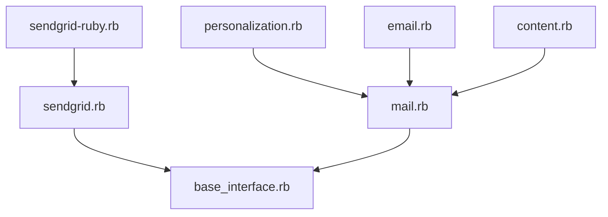

# sendgrid/sendgrid-ruby

> Official Ruby library for the Twilio SendGrid v3 web API, for sending emails.

## The problem
Sending transactional emails from Ruby without writing the API's HTTP calls yourself.

## What it actually does
A fluent-interface client calls all v3 endpoints with an API key. Mail, Personalization, Email and Content classes build the sending payload. Helpers handle inbound mail, verify webhooks and read statistics.

## How it is wired


## Trying it
```bash
gem install sendgrid-ruby
```
```ruby
sg = SendGrid::API.new(api_key: ENV['SENDGRID_API_KEY'])
response = sg.client.mail._('send').post(request_body: mail.to_json)
```

## Cost and gotchas
The SendGrid service starts on the free tier, with an API key to protect. Ruby 2.4 or later is required (except 2.6.0); Ruby is not in the prerequisites list.

## What it is not
Not a mail server: it is a client for a third-party service.

## Alternatives
No alternative named in the README.

## For you
Ignore: a Ruby client for a sending service, unrelated to data, AI or MLOps work.
