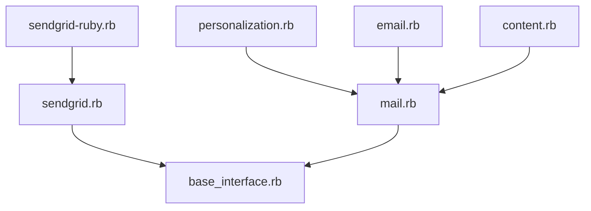

# sendgrid/sendgrid-ruby

> Bibliothèque Ruby officielle de l'API web v3 de Twilio SendGrid pour envoyer des courriels.

## Le problème
Envoyer des courriels transactionnels depuis Ruby sans écrire soi-même les appels HTTP de l'API.

## Ce que ça fait vraiment
Un client à interface fluide appelle tous les endpoints v3 avec une clé d'API. Des classes Mail, Personalization, Email et Content construisent la charge utile d'envoi. Des assistants traitent le courrier entrant, vérifient les webhooks et lisent les statistiques.

## Comment c'est branché


## Essayer
```bash
gem install sendgrid-ruby
```
```ruby
sg = SendGrid::API.new(api_key: ENV['SENDGRID_API_KEY'])
response = sg.client.mail._('send').post(request_body: mail.to_json)
```

## Coût et pièges
Le service SendGrid démarre au niveau gratuit, avec une clé d'API à protéger. Ruby 2.4 ou plus est requis (sauf 2.6.0) ; Ruby n'existe pas dans la liste des prérequis.

## Ce que ce n'est pas
Pas un serveur de courriel : c'est un client d'un service tiers.

## Alternatives
Aucune alternative nommée dans le README.

## Pour toi
À ignorer : client Ruby d'un service d'envoi, sans rapport avec le travail data, IA ou MLOps.

