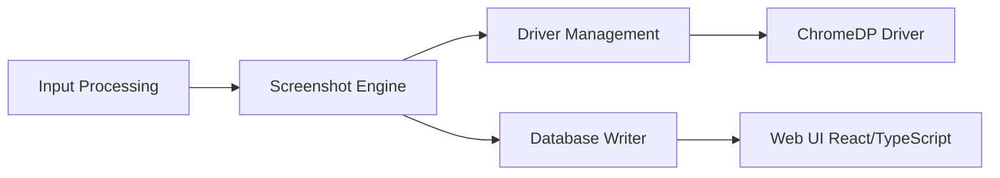

# sensepost/gowitness

> Go tool that captures web pages with headless Chrome, to map out targets.

## The problem
Visually checking hundreds of web interfaces (scan results) by hand is tedious.

## What it actually does
Readers (URL, CIDR, Nmap, Nessus) feed a capture engine based on chromedp or go-rod. Writers store the results in SQLite, CSV or JSON lines, with request logs, headers and cookies. A web interface and a REST API let you browse the captures.

## How it is wired


## Trying it
```bash
go install github.com/sensepost/gowitness@latest
gowitness scan single --url "https://sensepost.com" --write-db
```

## Cost and gotchas
Free; Chrome required. Windows "mostly works" according to the README. Use only on authorized targets.

## What it is not
It is not a vulnerability scanner: it captures and catalogs. The qualifiers "epic" and "fast and accurate" come from the README.

## Alternatives
No alternative named in the README.

## For you
Ignore: a security reconnaissance tool, unless you audit your own web surface.
