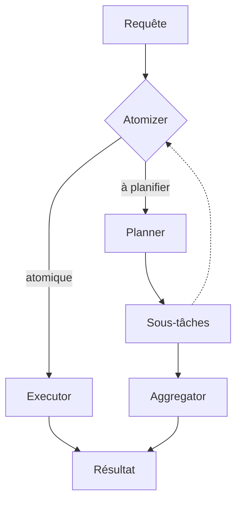

# sentient-agi/ROMA

> DSPy framework for recursive agents: a problem is split into subtasks, then re-aggregated, for AI engineers.

## The problem
Complex tasks exceed a single LLM call; they must be decomposed and recomposed in a traceable way.

## What it actually does
Recursive loop of Atomizer (atomic or not), Planner (subtasks with dependencies), Executor (LLM, API or agent, with ReAct/CodeAct tools), Aggregator, optional Verifier. Nine built-in toolkits (files, calculator, E2B, crypto, Serper search, MCP). Minimal mode without a database, or Docker with PostgreSQL, MLflow, FastAPI API, MinIO.

## How it is wired


## Trying it
```bash
uv pip install roma-dspy
export OPENROUTER_API_KEY="sk-or-v1-..."
python -c "from roma_dspy.core.engine.solve import solve; print(solve('What is 2+2?'))"
just setup
roma-dspy solve "Your task" --profile general
```

## Cost and gotchas
OpenRouter, OpenAI or Anthropic key at your expense; each recursive task multiplies the calls. Full mode: Docker, ~5-10 min installation. README truncated in the batch.

## What it is not
Not production-ready despite the "Production" section: the repository declares itself beta. No license declared in the catalog, so reuse is legally uncertain.

## Alternatives
DSPy, on which ROMA is built (the README names no other competitor).

## For you
Worth watching: the plan-execute-aggregate idea is useful to study, but the absence of a license blocks any professional use.
