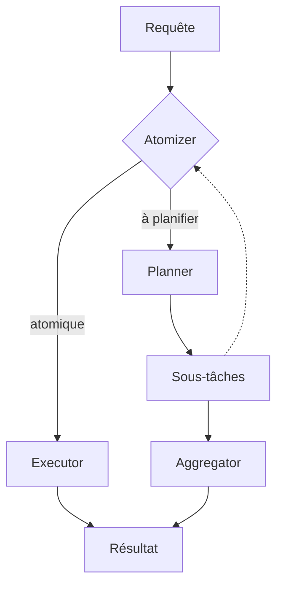

# sentient-agi/ROMA

> Framework DSPy d'agents récursifs : un problème est découpé en sous-tâches, puis réagrégé, pour ingénieurs IA.

## Le problème
Les tâches complexes dépassent un seul appel de LLM ; il faut les décomposer et recomposer de façon traçable.

## Ce que ça fait vraiment
Boucle récursive Atomizer (atomique ou non), Planner (sous-tâches avec dépendances), Executor (LLM, API ou agent, avec outils ReAct/CodeAct), Aggregator, Verifier optionnel. Neuf toolkits intégrés (fichiers, calculatrice, E2B, crypto, recherche Serper, MCP). Mode minimal sans base, ou Docker avec PostgreSQL, MLflow, API FastAPI, MinIO.

## Comment c'est branché


## Essayer
```bash
uv pip install roma-dspy
export OPENROUTER_API_KEY="sk-or-v1-..."
python -c "from roma_dspy.core.engine.solve import solve; print(solve('What is 2+2?'))"
just setup
roma-dspy solve "Your task" --profile general
```

## Coût et pièges
Clé OpenRouter, OpenAI ou Anthropic à ta charge ; chaque tâche récursive multiplie les appels. Mode complet : Docker, ~5-10 min d'installation. README tronqué dans le lot.

## Ce que ce n'est pas
Pas prêt pour la production malgré la section « Production » : le dépôt se déclare en bêta. Aucune licence déclarée au catalogue, donc réutilisation juridiquement incertaine.

## Alternatives
DSPy, sur lequel ROMA est construit (le README ne nomme pas d'autre concurrent).

## Pour toi
À surveiller : l'idée plan-exécute-agrège est utile à étudier, mais l'absence de licence bloque tout usage professionnel.

