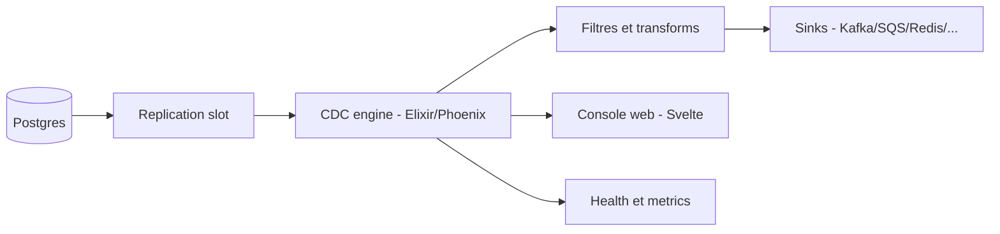

# sequinstream/sequin

> A change data capture (CDC) platform for Postgres, streaming to Kafka, queues, search indexes, etc.

## The problem
Streaming changes from a Postgres database to other systems forces you to set up Debezium and Kafka, or to cobble together fragile solutions.

## What it actually does
A Docker container deployed next to Postgres (14+), reading via logical replication. It filters, transforms (Elixir functions), routes and delivers to sinks (Kafka, SQS, SNS, Kinesis, Pub/Sub, Event Hubs, NATS, RabbitMQ, Redis, Elasticsearch, Typesense, Meilisearch, webhooks). Backfills, strict ordering, delivery with idempotency keys, web console, YAML/CLI, Prometheus metrics. The benchmarks (50k ops/s, 55 ms) come from the authors.

## How it is wired


## Trying it
```bash
# Aucune commande dans le README ; il renvoie au quickstart (~5 min).
# Terraform pour AWS : dossier deployment/
```

## Cost and gotchas
Free (MIT), but assumes Postgres with logical replication and a sink at your expense. Last push in February 2026: quieter activity.

## What it is not
Not a Postgres extension, nor a batch ETL. The README compares against Debezium, Fivetran and Airbyte with its own figures: reproduce them before relying on them.

## Alternatives
Debezium (more infrastructure, Kafka required), Fivetran and Airbyte (batch, much higher latency according to the README).

## For you
Adopt on a trial basis: to feed a data lake, a cache or a search index from Postgres without Kafka, it is direct and MIT-licensed.
