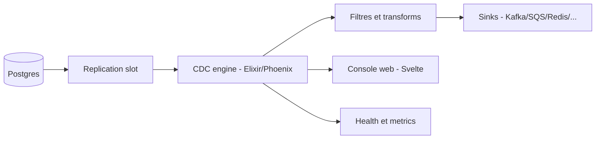

# sequinstream/sequin

> Plateforme de capture de changements (CDC) pour Postgres, qui diffuse vers Kafka, files, index de recherche, etc.

## Le problème
Diffuser les changements d'une base Postgres vers d'autres systèmes oblige à monter Debezium et Kafka, ou à bricoler des solutions fragiles.

## Ce que ça fait vraiment
Conteneur Docker déployé à côté de Postgres (14+), lu par réplication logique. Il filtre, transforme (fonctions Elixir), route et livre vers des sinks (Kafka, SQS, SNS, Kinesis, Pub/Sub, Event Hubs, NATS, RabbitMQ, Redis, Elasticsearch, Typesense, Meilisearch, webhooks). Backfills, ordre strict, livraison avec clés d'idempotence, console web, YAML/CLI, métriques Prometheus. Les benchmarks (50k ops/s, 55 ms) viennent des auteurs.

## Comment c'est branché


## Essayer
```bash
# Aucune commande dans le README ; il renvoie au quickstart (~5 min).
# Terraform pour AWS : dossier deployment/
```

## Coût et pièges
Gratuit (MIT), mais suppose Postgres avec réplication logique et un sink à ta charge. Dernier push en février 2026 : activité plus calme.

## Ce que ce n'est pas
Pas une extension Postgres, ni un ETL par lots. Le README compare à Debezium, Fivetran et Airbyte avec ses propres chiffres : à reproduire avant de s'y fier.

## Alternatives
Debezium (plus d'infrastructure, Kafka requis), Fivetran et Airbyte (par lots, latence bien plus élevée selon le README).

## Pour toi
Adopter à l'essai : pour alimenter un lac de données, un cache ou un index de recherche depuis Postgres sans Kafka, c'est direct et sous licence MIT.

