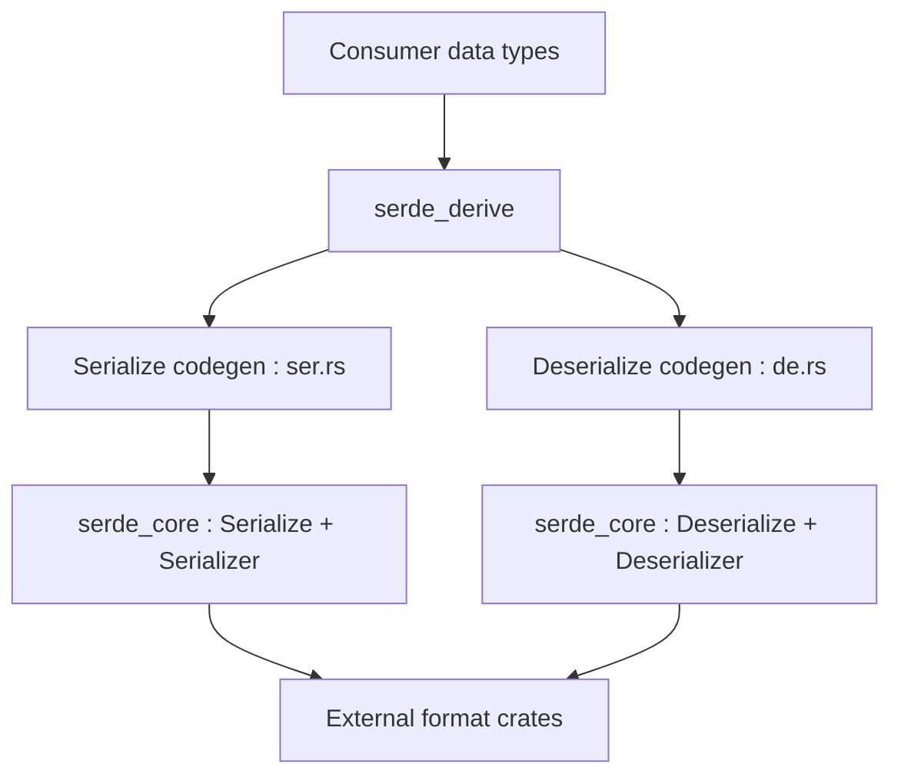

# serde-rs/serde

> Rust framework for generic serialization and deserialization, for Rust developers who read or write data formats.

## The problem
Converting Rust structures to JSON or another format without rewriting format-specific code each time.

## What it actually does
The crate defines the `Serialize` and `Deserialize` traits. A derive crate generates the code from `#[derive(Serialize, Deserialize)]`. Each format (for example serde_json) is a separate crate that implements the serializer and deserializer.

## How it is wired


## Trying it
```toml
[dependencies]
serde = { version = "1.0", features = ["derive"] }
serde_json = "1.0"
```
Then put `#[derive(Serialize, Deserialize, Debug)]` on a struct and call `serde_json::to_string(&point)`.

## Cost and gotchas
Free, Apache-2.0 license. You need a Rust project; the README states a minimum Rust version of 1.56 for serde and 1.71 for serde_derive.

## What it is not
It is not a data format: it does not write JSON by itself, you need a format crate alongside it.

## Alternatives
No alternative named in the README.

## For you
Ignore: essential in Rust, but irrelevant for a data, AI or MLOps profile working in Python.
