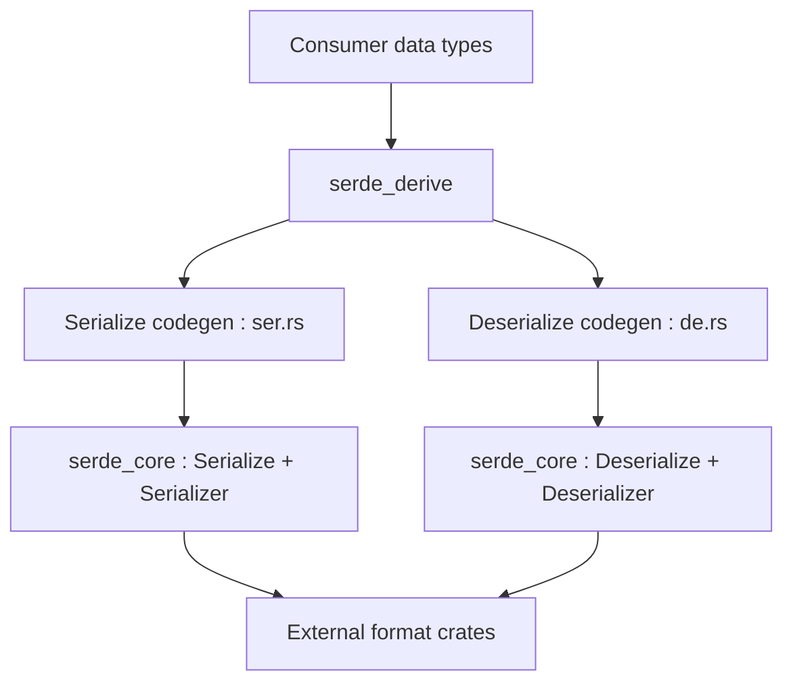

# serde-rs/serde

> Cadre Rust de sérialisation et désérialisation générique, pour développeurs Rust qui lisent ou écrivent des formats de données.

## Le problème
Convertir des structures Rust vers JSON ou un autre format, sans réécrire un code spécifique pour chaque format.

## Ce que ça fait vraiment
Le crate définit les traits `Serialize` et `Deserialize`. Un crate de dérivation génère le code à partir de `#[derive(Serialize, Deserialize)]`. Chaque format (par exemple serde_json) est un crate séparé qui implémente le sérialiseur et le désérialiseur.

## Comment c'est branché


## Essayer
```toml
[dependencies]
serde = { version = "1.0", features = ["derive"] }
serde_json = "1.0"
```
Puis `#[derive(Serialize, Deserialize, Debug)]` sur une structure et `serde_json::to_string(&point)`.

## Coût et pièges
Gratuit, licence Apache-2.0. Il faut un projet Rust ; le README indique une version minimale de Rust 1.56 pour serde et 1.71 pour serde_derive.

## Ce que ce n'est pas
Ce n'est pas un format de données : il n'écrit pas de JSON seul, il faut un crate de format à côté.

## Alternatives
Aucune alternative nommée dans le README.

## Pour toi
Ignorer : essentiel en Rust, mais sans objet pour un profil data, IA ou MLOps qui travaille en Python.

