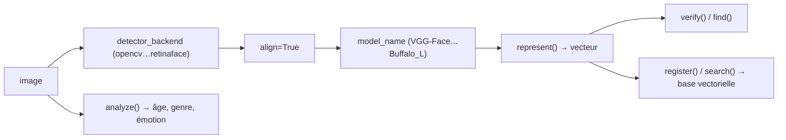

# serengil/deepface

> Face recognition and attribute analysis in Python, in a single function call.

## The problem
A face recognition pipeline chains five steps — detection, alignment, normalization,
representation, verification — and each one needs a different model, format and settings.

## What it actually does
A facade that wraps ten recognition models (VGG-Face by default, Facenet, ArcFace,
Dlib, SFace, GhostFaceNet, Buffalo_L…) and twenty detectors (OpenCV by default, RetinaFace, MtCnn,
YuNet, several YOLO). Five functions: `verify`, `find` (on-disk database), `search` (with
`register`, backed by postgres, mongo, neo4j, pgvector, pinecone, milvus, qdrant, weaviate),
`analyze` (age, gender, emotion, origin), `represent` (vectors), plus `stream` and an anti-spoofing check.

## How it is wired


## Trying it
```bash
pip install deepface[tensorflow]
```
```python
result = DeepFace.verify(img1_path = "img1.jpg", img2_path = "img2.jpg")
dfs = DeepFace.find(img_path = "img1.jpg", db_path = "C:/my_db")
objs = DeepFace.analyze(img_path = "img4.jpg", actions = ['age', 'gender', 'race', 'emotion'])
```

## Cost and gotchas
Free and local; the README also pushes a managed API (`deepface.dev`) with pay-as-you-go pricing,
with an MCP endpoint. The choice of detector weighs heavily on accuracy: the README claims +42%
from detection and +6% from alignment, and names RetinaFace as the best detector.

## What it is not
Not a decision: `analyze` produces estimates of age (±4.65 MAE claimed), gender and
"origin" — categories whose use is regulated and contestable. Anti-spoofing is
disabled by default (`anti_spoofing=True`). Not an interface: the React front end is a separate repository.

## Alternatives
- `deepface-react-ui`: separate repository, if usage has to go through a browser.
- `deepface.dev`: the hosted version, if infrastructure is not the point.

## For you
The reference for prototyping facial vision; production use is first and foremost a legal problem.
