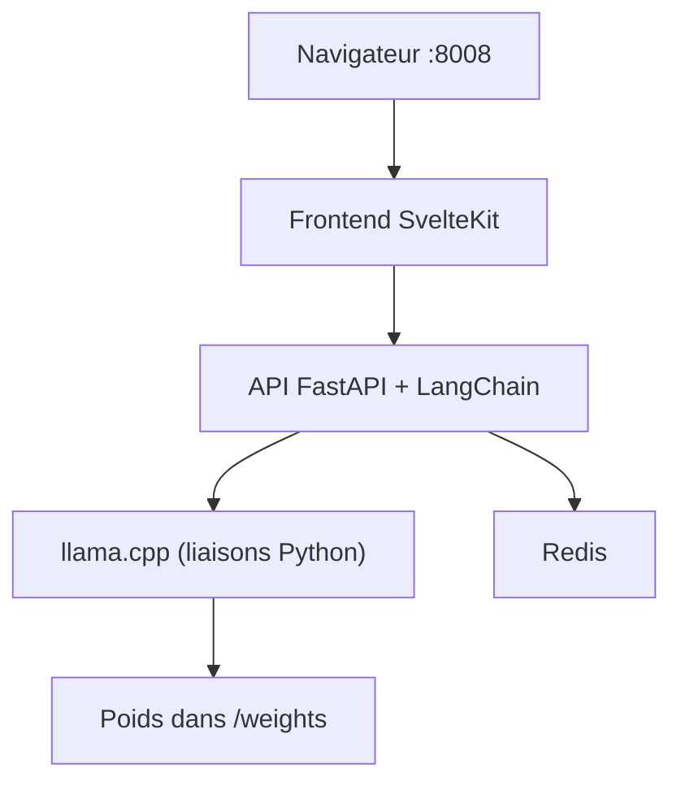

# serge-chat/serge

> Self-hosted chat interface to run LLaMA models through llama.cpp, with no API key.

## The problem
Using a local LLM means setting up an inference server and an interface yourself.

## What it actually does
Provides a SvelteKit interface, a FastAPI API with LangChain that calls llama.cpp through its Python bindings, and Redis storage for history and settings. A single container is published. The API is documented at /api/docs.

## How it is wired
Simplified diagram based on the sheet, no diagram provided.


## Trying it
```bash
docker run -d --name serge -v weights:/usr/src/app/weights -v datadb:/data/db/ -p 8008:8008 ghcr.io/serge-chat/serge:latest
# puis http://localhost:8008
```

## Cost and gotchas
Free, but you need enough RAM: LLaMA crashes otherwise. On Windows, Docker Desktop and WSL2. Change SERGE_JWT_SECRET, the default value is public. Archived, last push in November 2025.

## What it is not
Not a production inference server: it is a chat interface. No more updates for supported models.

## Alternatives
No alternative named in the README.

## For you
Ignore: archived; to try a local model, go straight through llama.cpp.
