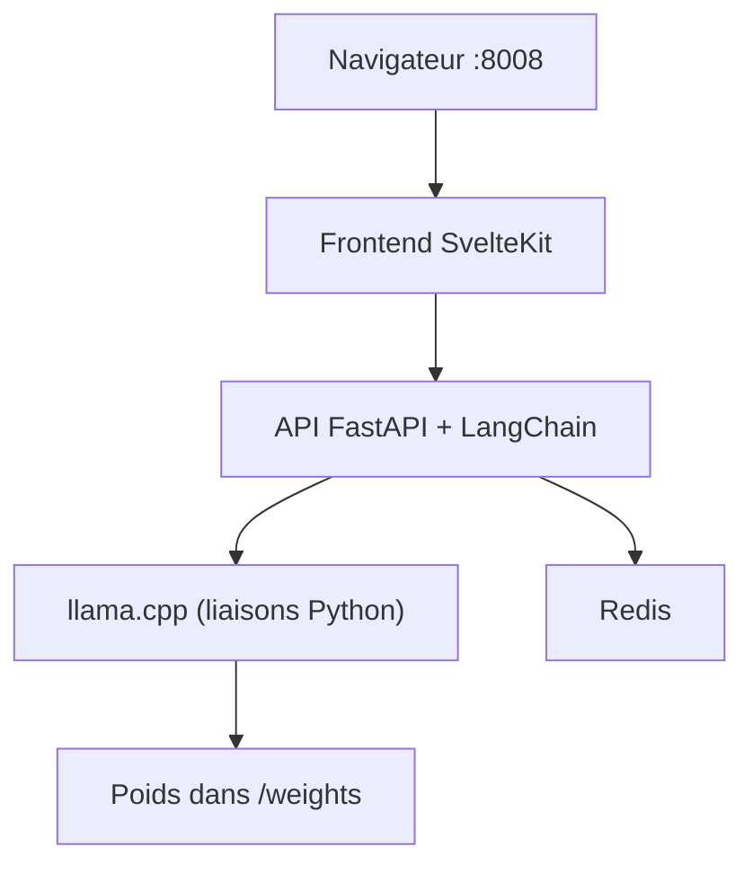

# serge-chat/serge

> Interface de chat auto-hébergée pour faire tourner des modèles LLaMA via llama.cpp, sans clé d'API.

## Le problème
Utiliser un LLM local demande de monter soi-même un serveur d'inférence et une interface.

## Ce que ça fait vraiment
Fournit une interface SvelteKit, une API FastAPI avec LangChain qui appelle llama.cpp par ses liaisons Python, et un stockage Redis pour l'historique et les paramètres. Un conteneur unique est publié. L'API est documentée sur /api/docs.

## Comment c'est branché
Schéma simplifié d'après la fiche, sans diagramme fourni.


## Essayer
```bash
docker run -d --name serge -v weights:/usr/src/app/weights -v datadb:/data/db/ -p 8008:8008 ghcr.io/serge-chat/serge:latest
# puis http://localhost:8008
```

## Coût et pièges
Gratuit, mais il faut assez de RAM : LLaMA plante sinon. Sous Windows, Docker Desktop et WSL2. Changer SERGE_JWT_SECRET, la valeur par défaut est publique. Archivé, dernier push en novembre 2025.

## Ce que ce n'est pas
Pas un serveur d'inférence de production : c'est une interface de discussion. Plus de mises à jour des modèles supportés.

## Alternatives
Aucune alternative nommée dans le README.

## Pour toi
À ignorer : archivé ; pour tester un modèle local, passe directement par llama.cpp.

