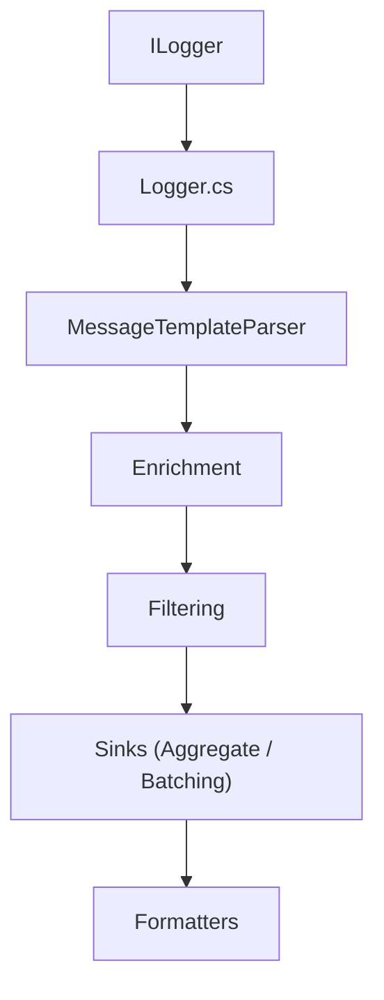

# serilog/serilog

> Structured logging library for .NET applications, with many sinks.

## The problem
Plain-text logs are hard to search and analyze without regex or parsing.

## What it actually does
Records structured events via message templates (`{@Position}`, `{Elapsed}`), keeping named properties. Sends to console, files, log servers, databases or message queues via sinks. Enriches events (LogContext, thread ids), supports OTLP and ASP.NET Core.

## How it is wired


## Trying it
```bash
dotnet add package Serilog
dotnet add package Serilog.Sinks.Console
dotnet add package Serilog.Sinks.File
```

## Cost and gotchas
Free. You must add one NuGet package per desired sink. C# configuration is the main route; XML and JSON are optional.

## What it is not
Not a log server or an analysis tool: it produces and routes events. Only for the .NET ecosystem.

## Alternatives
No alternative named in the README.

## For you
Ignore unless you write .NET: it is a good library, but its ecosystem is foreign to a data/AI/MLOps profile.
