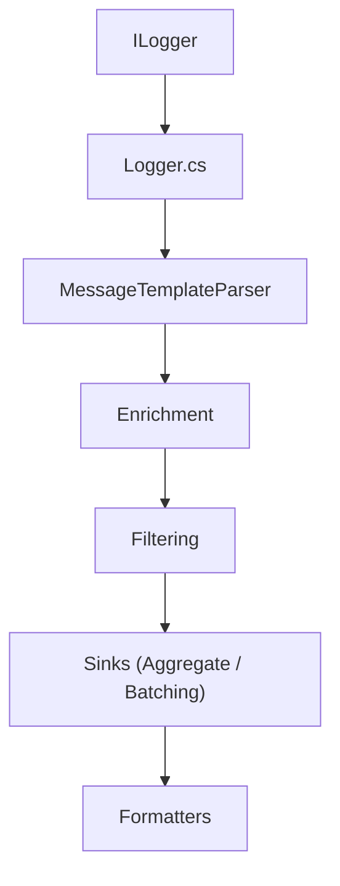

# serilog/serilog

> Bibliothèque de journalisation structurée pour applications .NET, avec nombreux sinks.

## Le problème
Les logs en texte brut sont difficiles à chercher et analyser sans regex ni parsing.

## Ce que ça fait vraiment
Enregistre des événements structurés via des modèles de messages (`{@Position}`, `{Elapsed}`), conservant les propriétés nommées. Envoie vers console, fichiers, serveurs de logs, bases ou files de messages via des sinks. Enrichit les événements (LogContext, ids de thread), prend en charge OTLP et ASP.NET Core.

## Comment c'est branché


## Essayer
```bash
dotnet add package Serilog
dotnet add package Serilog.Sinks.Console
dotnet add package Serilog.Sinks.File
```

## Coût et pièges
Gratuit. Il faut ajouter un paquet NuGet par sink souhaité. Une configuration C# est la voie principale ; XML et JSON sont optionnels.

## Ce que ce n'est pas
Pas un serveur de logs ni un outil d'analyse : il produit et route les événements. Uniquement pour l'écosystème .NET.

## Alternatives
Aucune alternative nommée dans le README.

## Pour toi
À ignorer sauf si tu écris du .NET : c'est une bonne bibliothèque, mais son écosystème est étranger à un profil data/IA/MLOps.

