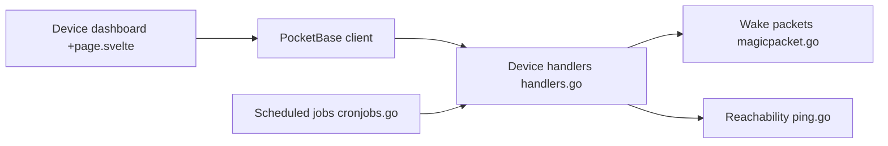

# seriousm4x/UpSnap

> Self-hosted dashboard to wake the machines on your network with Wake-on-LAN.

## The problem
Powering on local machines remotely without remembering MAC addresses and commands.

## What it actually does
One button wakes a device (magic packet), schedules actions with cron, tests ports, scans the network (nmap) and tracks IPs via ARP. Can shut down through a custom command. Multi-user management with per-device rights, 35 themes.

## How it is wired


## Trying it
```bash
sudo ./upsnap serve --http=0.0.0.0:8090
docker run --network=host seriousm4x/upsnap:latest
```

## Cost and gotchas
Free. Do not expose it to the Internet: the shutdown command is a potentially root shell; the README recommends a VPN.

## What it is not
Not a full fleet administration tool: only power on, power off, ping and scan.

## Alternatives
No alternative named in the README.

## For you
Ignore for AI: useful to a homelab, for example waking a GPU server on demand, but outside your core work.
