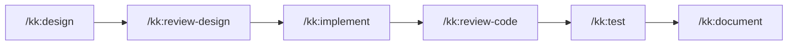

# serpro69/claude-toolbox

> Ready-to-use configuration and 16 skills for Claude Code and Codex, aimed at developers.

## The problem
Copy-pasting your settings, hooks and recurring prompts from one project to the next is tedious and quickly drifts out of sync.

## What it actually does
Provides a minimal configuration for Claude Code and Codex (permissions, statusline, MCP servers) with synchronization across projects. Adds 16 skills forming a pipeline: design, design review, implementation, code review, tests, documentation. A multi-model review relies on external models, and a knowledge base persists via Capy.

## How it is wired
Simplified diagram based on the sheet, no diagram provided.



## Trying it
```bash
/kk:brainstorm
/kk:design
/kk:review-design your-feature
/kk:implement
/kk:review-code
/kk:clarify-docs issue-draft.md
```

## Cost and gotchas
Free in itself, but you need Claude Code or Codex, plus Context7, Capy or an external model for the isolated review. The README admits the project is written with the help of Claude Code.

## What it is not
Not an autonomous agent: it is a set of skills and configuration. Detailed installation (template, plugin only) is in external documentation, not reproduced here.

## Alternatives
No alternative named in the README.

## For you
Worth watching: if you work with Claude Code, the review and design skills are a good source of ideas, but the license still needs to be checked before reuse.
