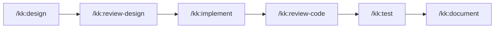

# serpro69/claude-toolbox

> Configuration prête à l'emploi et 16 skills pour Claude Code et Codex, à destination des développeurs.

## Le problème
Copier-coller ses réglages, hooks et prompts récurrents d'un projet à l'autre est fastidieux et se désynchronise vite.

## Ce que ça fait vraiment
Fournit une configuration minimale de Claude Code et Codex (permissions, statusline, serveurs MCP) avec une synchronisation entre projets. Ajoute 16 skills formant un pipeline : design, revue du design, implémentation, revue du code, tests, documentation. Une revue multi-modèles s'appuie sur des modèles externes, et une base de connaissances persiste via Capy.

## Comment c'est branché
Schéma simplifié d'après la fiche, sans diagramme fourni.



## Essayer
```bash
/kk:brainstorm
/kk:design
/kk:review-design your-feature
/kk:implement
/kk:review-code
/kk:clarify-docs issue-draft.md
```

## Coût et pièges
Gratuit en soi, mais il faut Claude Code ou Codex, et Context7, Capy ou un modèle externe pour la revue isolée. Le README admet que le projet est écrit avec l'aide de Claude Code.

## Ce que ce n'est pas
Pas un agent autonome : c'est un ensemble de skills et de configuration. L'installation détaillée (modèle, plugin seul) est dans une documentation externe, non reprise ici.

## Alternatives
Aucune alternative nommée dans le README.

## Pour toi
À surveiller : si tu travailles avec Claude Code, les skills de revue et de conception sont un bon réservoir d'idées, mais la licence reste à vérifier avant réutilisation.

