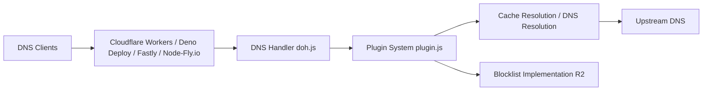

# serverless-dns/serverless-dns

> Encrypted DNS resolver (DoH/DoT) with content blocking, deployable on edge platforms.

## The problem
A DNS-level ad and tracker blocker like Pi-hole assumes you have your own server, running all the time.

## What it actually does
A DoH and DoT stub resolver that runs on Cloudflare Workers, Deno Deploy, Fastly Compute@Edge or Fly.io (Node). It filters requests with more than 200 blocklists (about 17 M entries) compressed in a radix tree, downloaded from Cloudflare R2. It handles caching, token authentication, TLS PSK, and logs via Logpush. According to the README, the platforms' free tiers cover 10 to 20 devices.

## How it is wired


## Trying it
```bash
git clone https://github.com/serverless-dns/serverless-dns.git
cd ./serverless-dns
npm i
./run n
```
Other runtimes: `./run d` (Deno), `./run f` (Fastly), `./run w` (Wrangler). Workers deployment: `npm run build` then `npx wrangler publish`.

## Cost and gotchas
An account with at least one platform (Cloudflare is the easiest; Fly.io is "difficult"). Free tiers can be exceeded. Logs and analytics are not implemented on Fly and Deno Deploy. The README points out API differences between Deno and Deno Deploy.

## What it is not
Not a standalone recursive resolver: it relies on upstream DNS (1.1.1.2 by default on Node). It is not a data tool: it depends on third-party infrastructure and on the lists hosted by the project.

## Alternatives
- Pi-hole: the classic self-hosted option, cited by the README as the reference of the genre.

## For you
Ignore for a data/AI/MLOps profile: it is personal DNS infrastructure unrelated to your field, and it depends on third-party platforms.
