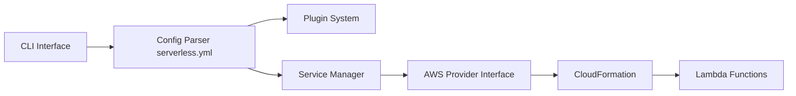

# serverless/serverless

> YAML CLI to deploy Lambda functions and the associated AWS infrastructure, for cloud developers.

## The problem
Deploying code to Lambda with its triggers, tables and buckets by hand in CloudFormation is slow and fragile.

## What it actually does
A `serverless.yml` file describes a "Service" (functions, events, resources); the CLI translates it into CloudFormation and deploys. V.4 adds a `dev` mode that routes Lambda events back to your local code, `diff`, multi-service Compose, native TypeScript via ESBuild, and Bedrock AgentCore support. Non-AWS providers are deprecated.

## How it is wired


## Trying it
```bash
npm i serverless -g
serverless
serverless deploy
serverless dev
sls remove
```

## Cost and gotchas
V.4 requires authentication in the CLI and a new license; free "for small organizations", otherwise paid pricing. AWS account and AWS bill are on you. Automatic updates by default.

## What it is not
No longer a multi-cloud tool: AWS only. Not a faithful local emulator; the README advises against full emulation.

## Alternatives
None named in the README as competitors (AWS SAM and CloudFormation are supported, not proposed as alternatives).

## For you
Useful for exposing a model on Lambda on AWS; check the V.4 license first if your organization is not "small".
