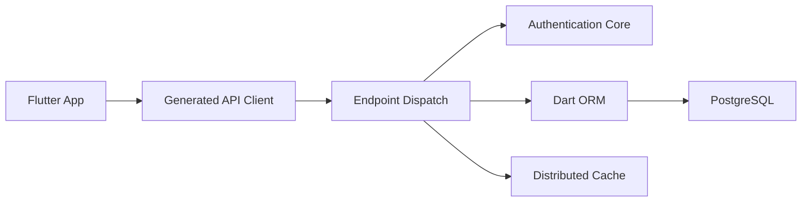

# serverpod/serverpod

> Application server written in Dart with API generation, for Flutter developers.

## The problem
A Flutter application needs a backend, an API client and database access, all written by hand.

## What it actually does
Generates the models and the client from the server, and offers a Dart ORM on PostgreSQL, migrations, a distributed cache (Redis), logging, authentication (Google, Apple, Firebase, email), socket streams, scheduled calls, uploads, health checks and an experimental web server.

## How it is wired


## Trying it
```bash
# non documenté dans le README : liens « Get Started » en ligne
```

## Cost and gotchas
PostgreSQL, Redis optional; Terraform scripts for GCP and AWS. The web server is described as experimental.

## What it is not
Not a data/AI tool: a backend for Flutter applications.

## Alternatives
- None cited in the README.

## For you
Ignore: the Dart/Flutter ecosystem is outside the data/AI/MLOps scope.
