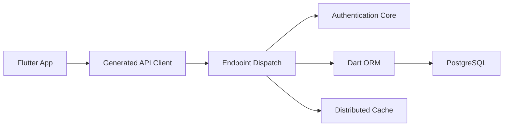

# serverpod/serverpod

> Serveur d'applications écrit en Dart avec génération d'API, pour développeurs Flutter.

## Le problème
Une application Flutter a besoin d'un backend, d'un client d'API et d'un accès base de données écrits à la main.

## Ce que ça fait vraiment
Génère les modèles et le client à partir du serveur, propose un ORM Dart sur PostgreSQL, migrations, cache distribué (Redis), journalisation, authentification (Google, Apple, Firebase, e-mail), flux par sockets, appels planifiés, téléversements, contrôles de santé et serveur web expérimental.

## Comment c'est branché


## Essayer
```bash
# non documenté dans le README : liens « Get Started » en ligne
```

## Coût et pièges
PostgreSQL, Redis facultatif ; scripts Terraform pour GCP et AWS. Le serveur web est dit expérimental.

## Ce que ce n'est pas
Pas un outil data/IA : un backend pour applications Flutter.

## Alternatives
- Aucune citée dans le README.

## Pour toi
À ignorer : écosystème Dart/Flutter hors du périmètre data/IA/MLOps.

