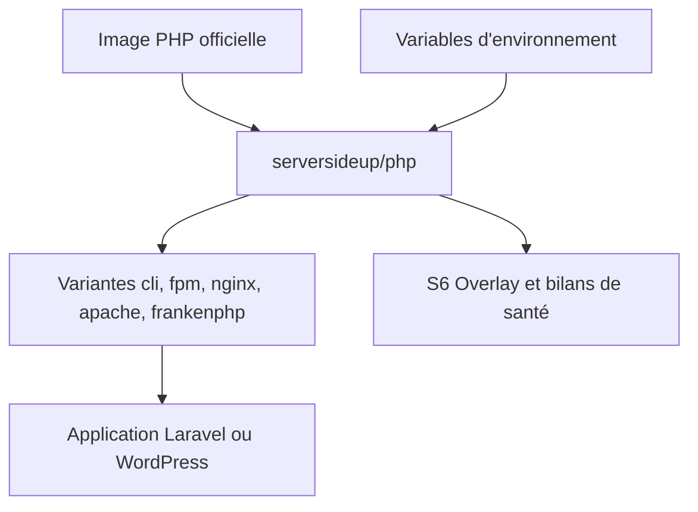

# serversideup/docker-php

> Production-ready PHP Docker images, built for Laravel, WordPress and modern PHP.

## The problem
The official PHP images need a lot of tuning to run safely in production.

## What it actually does
Adds to the official PHP images an unprivileged user, common extensions, Composer, health checks and unified logging (S6 Overlay). Variants: cli, fpm, fpm-apache, fpm-nginx, frankenphp. Laravel automations (migrations, queues, Horizon) at startup via `AUTORUN_ENABLED`.

## How it is wired
Simplified diagram based on the fiche, no diagram provided.



## Trying it
```yaml
services:
  php:
    image: serversideup/php:8.5-fpm-nginx
    ports:
      - "80:8080"
    environment:
      PHP_MEMORY_LIMIT: "512M"
      AUTORUN_ENABLED: "true"
    volumes:
      - .:/var/www/html
```

## Cost and gotchas
Free, GPL-3.0. Docker required. The README also promotes the company's paid offerings (consulting services, premium products).

## What it is not
Not a PHP framework: only images. The README documents neither performance measurements nor quantified security guarantees here.

## Alternatives
No alternative named in the README.

## For you
Worth watching: useful only if you deploy a PHP application; no direct link with data or AI.
