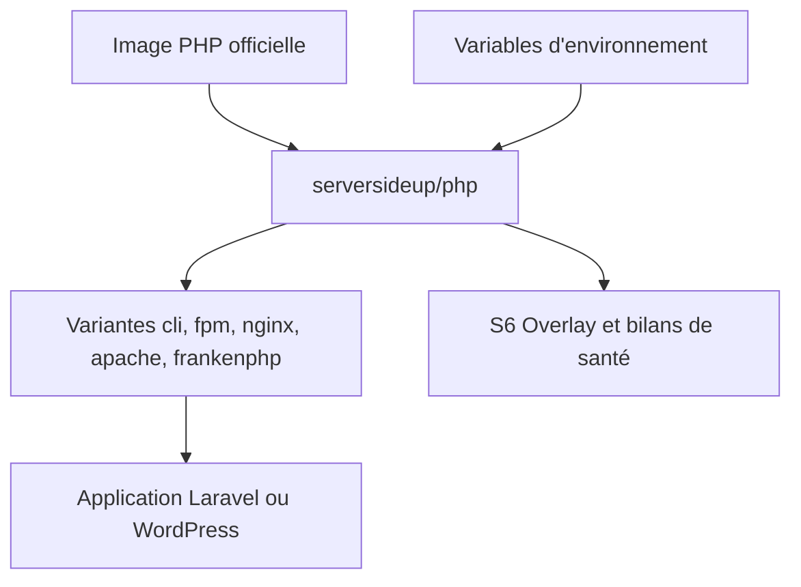

# serversideup/docker-php

> Images Docker PHP prêtes pour la production, pensées pour Laravel, WordPress et PHP moderne.

## Le problème
Les images PHP officielles demandent beaucoup de réglages pour tourner de façon sûre en production.

## Ce que ça fait vraiment
Ajoute aux images PHP officielles un utilisateur non privilégié, des extensions courantes, Composer, des bilans de santé et la journalisation unifiée (S6 Overlay). Variantes : cli, fpm, fpm-apache, fpm-nginx, frankenphp. Automatisations Laravel (migrations, files d'attente, Horizon) au démarrage via `AUTORUN_ENABLED`.

## Comment c'est branché
Schéma simplifié d'après la fiche, sans diagramme fourni.



## Essayer
```yaml
services:
  php:
    image: serversideup/php:8.5-fpm-nginx
    ports:
      - "80:8080"
    environment:
      PHP_MEMORY_LIMIT: "512M"
      AUTORUN_ENABLED: "true"
    volumes:
      - .:/var/www/html
```

## Coût et pièges
Gratuit, GPL-3.0. Docker requis. Le README promeut aussi des offres payantes de la société (services de conseil, produits premium).

## Ce que ce n'est pas
Pas un framework PHP : seulement des images. Le README ne documente ici ni mesures de performance ni garanties de sécurité chiffrées.

## Alternatives
Aucune alternative nommée dans le README.

## Pour toi
À surveiller : utile seulement si tu déploies une application PHP ; sans lien direct avec la data ou l'IA.

