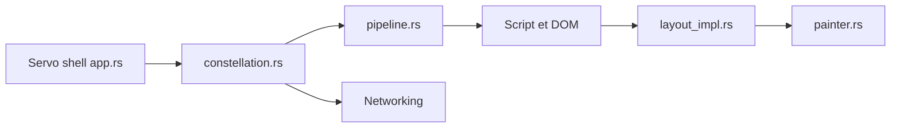

# servo/servo

> Prototype of a browser engine written in Rust, for anyone who wants an embeddable, parallel web engine.

## The problem
Existing browser engines are huge and written in C++; a modern, memory-safe, parallelized engine is missing.

## What it actually does
The shell receives navigation and input; the Constellation coordinates browsing contexts and pipelines; content runs (script, DOM, CSS), layout produces display lists, then painting follows. Services: network, cookies, web storage, media, fonts, WebGPU, DevTools, WebDriver. Targets: macOS, Linux, Windows, Android, OpenHarmony.

## How it is wired


## Trying it
```bash
./mach bootstrap
./mach build
```
Prerequisites: `uv` and `rustup`. Android and OpenHarmony require SDKs and environment variables.

## Cost and gotchas
Free; long compilation and a heavy toolchain. The README calls it a "prototype". The links between components in the diagram are partly inferred (dashed edges).

## What it is not
Not a ready-to-use mainstream browser. Not a scraping tool.

## Alternatives
No alternative named in the README.

## For you
Keep an eye on it: little direct use in data/AI; worth following for an embeddable web engine or headless rendering.
