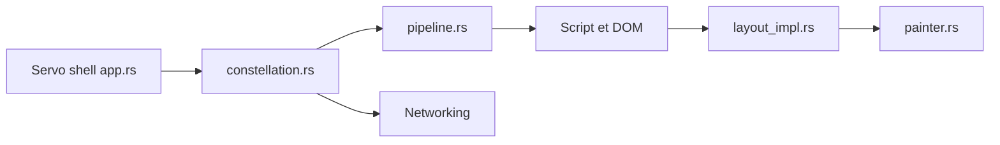

# servo/servo

> Prototype de moteur de navigateur écrit en Rust, pour qui veut un moteur web embarquable et parallèle.

## Le problème
Les moteurs de navigateur existants sont énormes et écrits en C++ ; il manque un moteur moderne, sûr en mémoire et parallélisé.

## Ce que ça fait vraiment
Le shell reçoit navigation et entrées ; la Constellation coordonne contextes de navigation et pipelines ; le contenu s'exécute (script, DOM, CSS), la mise en page produit des listes d'affichage, puis la peinture. Services : réseau, cookies, stockage web, médias, polices, WebGPU, DevTools, WebDriver. Cibles : macOS, Linux, Windows, Android, OpenHarmony.

## Comment c'est branché


## Essayer
```bash
./mach bootstrap
./mach build
```
Prérequis : `uv` et `rustup`. Android et OpenHarmony demandent des SDK et variables d'environnement.

## Coût et pièges
Gratuit ; compilation longue et chaîne d'outils lourde. Le README parle d'un « prototype ». Les liens entre composants du schéma sont en partie déduits (arêtes en pointillés).

## Ce que ce n'est pas
Pas un navigateur grand public prêt à l'emploi. Pas un outil de scraping.

## Alternatives
Aucune alternative nommée dans le README.

## Pour toi
Surveiller : peu d'usage direct en data/IA ; à suivre pour un moteur web embarquable ou un rendu sans tête.

