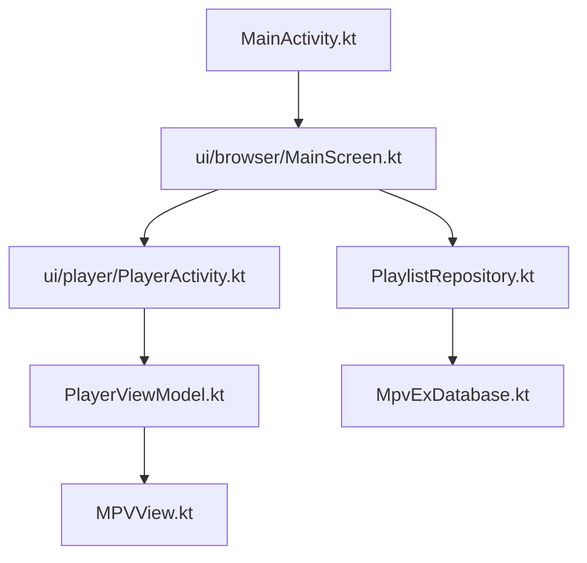

# sfsakhawat999/mpvRex

> Android video player based on libmpv, with a Compose interface, for people who watch local or network files.

## The problem
Default Android players handle gestures, formats and network sources poorly.

## What it actually does
Playback through libmpv with gestures, zoom, frame-by-frame navigation, playlists and tracking of watched videos. It opens SMB, WebDAV, FTP and Jellyfin media, and an optional yt-dlp companion handles web streaming. Data is kept in a Room database.

## How it is wired

## Trying it
No documented command: the README's Installation section is empty.

## Cost and gotchas
Free. The repository has moved to mpvRex/REX-Player: old links redirect. 150 open issues.

## What it is not
Not a work tool: it is a consumer player. The README gives no installation procedure and no license details beyond the one in the catalog.

## Alternatives
No alternative cited in the README (mpvEx and mpv-android are cited as origins).

## For you
Ignore: mobile video player with no link to a data or AI workflow.
