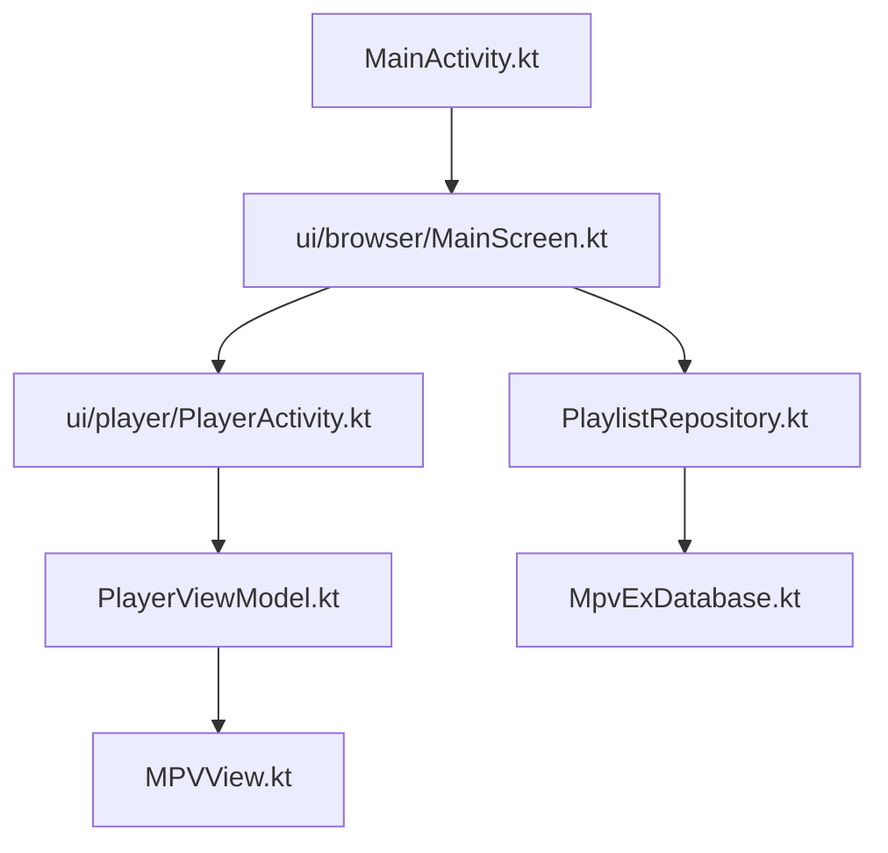

# sfsakhawat999/mpvRex

> Lecteur vidéo Android basé sur libmpv, avec interface Compose, pour qui regarde des fichiers locaux ou réseau.

## Le problème
Les lecteurs Android par défaut gèrent mal les gestes, les formats et les sources réseau.

## Ce que ça fait vraiment
Lecture via libmpv avec gestes, zoom, navigation image par image, playlists et suivi des vidéos vues. Il ouvre des médias SMB, WebDAV, FTP et Jellyfin, et un compagnon yt-dlp optionnel pour le streaming web. Les données sont dans une base Room.

## Comment c'est branché

## Essayer
Aucune commande documentée : la section Installation du README est vide.

## Coût et pièges
Gratuit. Le dépôt a déménagé vers mpvRex/REX-Player : les anciens liens redirigent. 150 issues ouvertes.

## Ce que ce n'est pas
Pas un outil de travail : c'est un lecteur grand public. Le README ne donne ni procédure d'installation ni licence détaillée au-delà de celle du catalogue.

## Alternatives
Aucune alternative citée dans le README (mpvEx et mpv-android sont cités comme origines).

## Pour toi
Ignorer : lecteur vidéo mobile sans lien avec un flux data ou IA.

