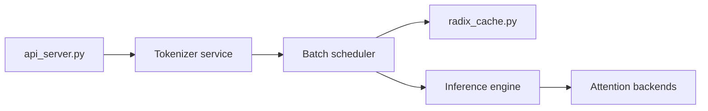

# sgl-project/mini-sglang

> Compact LLM inference engine of about 5,000 lines of Python, to be read as an educational reference.

## The problem
Modern LLM serving engines are hard to understand because of their size.

## What it actually does
OpenAI-compatible server and interactive shell, with a radix cache to reuse prefixes, chunked prefill, overlap scheduling, tensor parallelism, FlashAttention and FlashInfer. Llama, Mistral, Qwen2, Qwen3 and Qwen3-MoE models. A separate tokenization service offloads the CPU.

## How it is wired


## Trying it
```bash
git clone https://github.com/sgl-project/mini-sglang.git
cd mini-sglang && uv venv --python=3.12 && source .venv/bin/activate
uv pip install -e .
python -m minisgl --model "Qwen/Qwen3-0.6B"
```

## Cost and gotchas
Linux only, NVIDIA GPU, a CUDA Toolkit compatible with the driver, kernels compiled on the fly. WSL2 or Docker on Windows.

## What it is not
Not a replacement for SGLang in production: the README describes it as a compact, educational version.

## Alternatives
- SGLang: the full engine it is derived from and against which the README compares itself.

## For you
Worth watching: very good for understanding how an LLM server works, less so for serving models to users.
