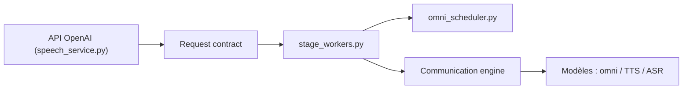

# sgl-project/sglang-omni

> Multi-stage serving runtime for omni, speech and TTS models, with an OpenAI-compatible API.

## The problem
Models that mix text, audio and speech generate in several heterogeneous stages that standard LLM servers handle poorly.

## What it actually does
Models generation as coordinated stages (preprocessing, encoders, autoregressive engines, talkers, decoders, vocoders) with a scheduler suited to each, SGLang serving the autoregressive stages. Tensors move through shared memory, NCCL, NIXL or Mooncake. Exposes multimodal chat, speech (batch, streaming, uploaded voices) and transcription. Multi-worker router.

## How it is wired


## Trying it
```bash
./install.sh
```
The only command given: installation on macOS Apple Silicon; the rest points to the documentation.

## Cost and gotchas
A GPU is expected for the served models; the model list is broad (Qwen3-Omni, Fish Speech, etc.). 655 open issues: a project in motion.

## What it is not
Not a model nor an application: it is the serving infrastructure. The README gives few usage details.

## Alternatives
- SGLang: the autoregressive execution base that the project composes.

## For you
Worth watching: relevant if you serve speech or omni at scale; young (January 2026) and very active, hence unstable.
