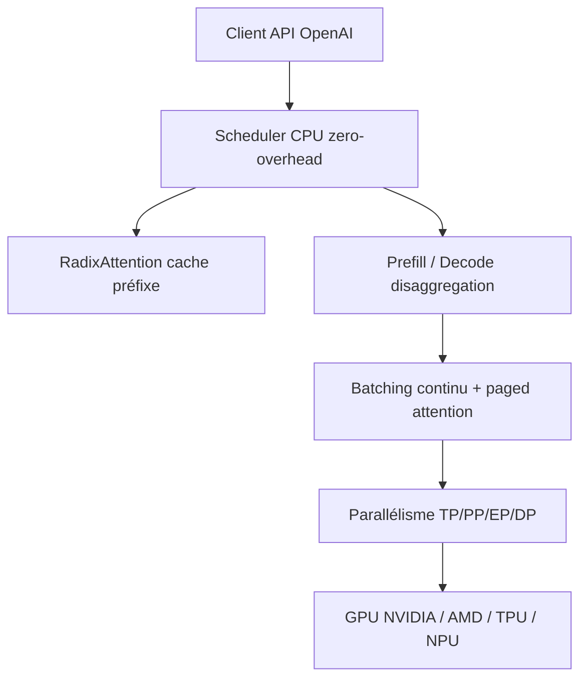

# sgl-project/sglang

> Inference server for LLMs and multimodal models, from a single GPU to a distributed cluster.

## The problem
Serving an LLM with proper batching, prefix caching and parallelism requires a homegrown stack.
Without it, you pay twice: request latency and underused GPUs in production.

## What it actually does
Serving runtime: RadixAttention for prefix caching, zero-overhead CPU scheduler, prefill/decode disaggregation, speculative decoding, continuous batching, paged attention.
Tensor / pipeline / expert / data parallelism, structured outputs, chunked prefill, FP4/FP8/INT4/AWQ/GPTQ quantization, multi-LoRA batching.
Covers Llama, Qwen, DeepSeek, Kimi, GLM, GPT, Gemma, Mistral, embedding models (e5-mistral, gte, mcdse), reward models (Skywork) and diffusion models (WAN, Qwen-Image); OpenAI-compatible API.
Hardware: NVIDIA GPUs (GB200/B300/H100/A100/Spark/5090), AMD (MI355/MI300), Intel Xeon CPUs, Google TPUs, Ascend NPUs. Also serves as a rollout backend for AReaL, Miles, slime, Tunix, verl.

## How it is wired

## Trying it
No installation command is written in the README: it points to "Install SGLang", "Quick Start", "Backend Tutorial" and "Frontend Tutorial". Not documented here.

## Cost and gotchas
Free software, but you need the GPU: the bill is hardware, not software.
The README mentions a commercial contact for large-scale deployment and a coding-agent sponsorship for regular contributors.

## What it is not
Not a training framework: it is a serving engine, used as a rollout backend by third-party post-training frameworks.
Not a GPU-less solution nor a hosted service: you operate the server.
The README acknowledges reusing ideas and code from Guidance, vLLM, LightLLM, FlashInfer, Outlines and LMQL.

## Alternatives
- vLLM — cited as a source of inspiration; same serving niche, older ecosystem.
- LightLLM — another lightweight serving runtime, named in the acknowledgments.
- FlashInfer — attention building block, preferable if you build your own engine.

## For you
To adopt as soon as you serve an LLM in-house: it is the best-equipped inference foundation on the list.
