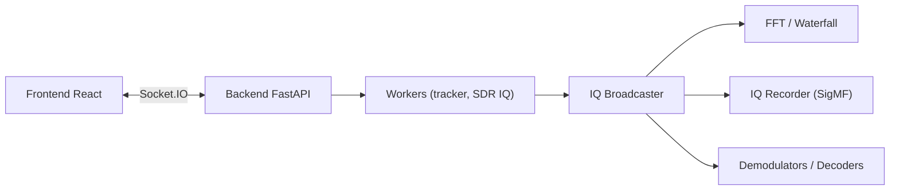

# sgoudelis/ground-station

> Web application to track satellites, drive antennas and SDR radios, and decode their signals.

## The problem
Tracking a satellite pass, pointing a rotator, correcting Doppler, recording and decoding the signal means stitching together several separate radio tools.

## What it actually does
A FastAPI + Socket.IO backend orchestrates worker processes: orbit tracking (Skyfield/SGP4), IQ acquisition from RTL-SDR, SoapySDR or UHD, FFT/waterfall, demodulation, SigMF recording and decoders (SSTV, APRS, GMSK…). An APScheduler scheduler launches automatic observations. The interface is in React/Redux/MUI. Some decoders are marked as under development in the README.

## How it is wired


## Trying it
```bash
docker pull ghcr.io/sgoudelis/ground-station:<version>
docker run -d --platform linux/amd64 -p 7000:7000 --name ground-station \
  --restart unless-stopped --device=/dev/bus/usb --privileged \
  -v /path/to/data:/app/backend/data \
  ghcr.io/sgoudelis/ground-station:<version>
```

## Cost and gotchas
Free, but requires radio hardware (SDR, rotator) and USB access in `--privileged` mode. The image bundles the proprietary SDRplay API, whose EULA must be accepted. Intended for use on a trusted private network.

## What it is not
Not a data science or AI tool. The README states that development is assisted by LLM agents.

## Alternatives
- SatDump: satellite image decoding, used here as an option.
- gr-satellites: GNU Radio decoding modules, used here as a dependency.

## For you
Ignore for a data/AI/MLOps profile: it is an amateur radio tool unrelated to your scope, and it relies on dedicated hardware.
