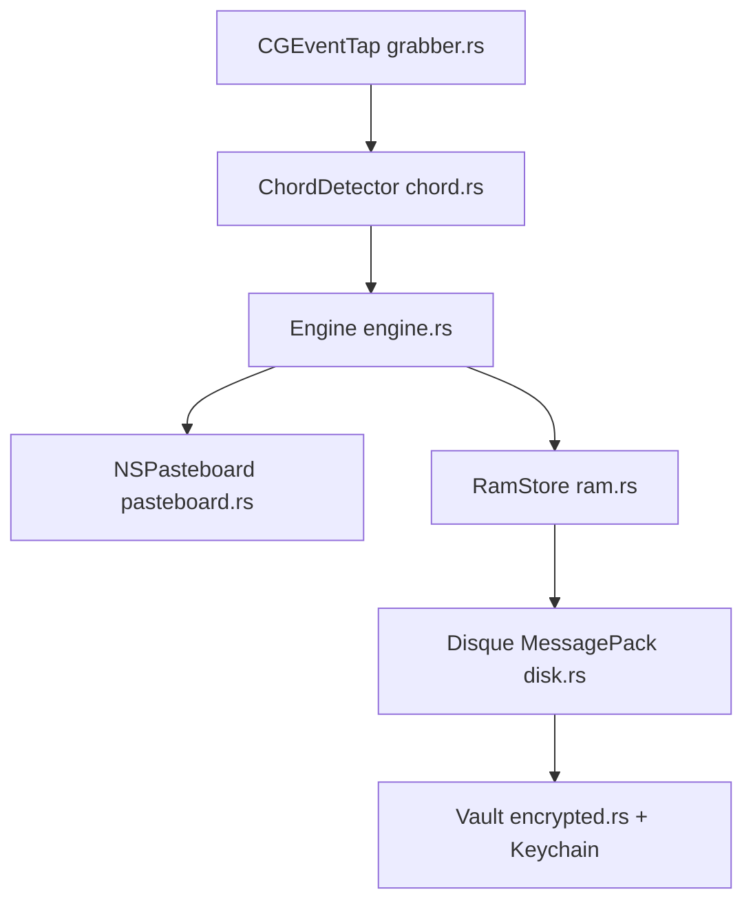

# shaaravraghu/ClipWallet

> Encrypted macOS clipboard manager with multiple slots, keyboard-driven.

## The problem
Every copy erases the previous one, and you lose what you copied thirty seconds earlier.

## What it actually does
A Rust daemon launched by launchd intercepts keyboard shortcuts, keeps 9 fixed slots or a ring of 50 entries, writes everything to disk in MessagePack and encrypts sensitive entries with AES-256-GCM, the key being stored in the macOS Keychain.

## How it is wired
Simplified diagram based on the fiche, no diagram provided.



## Trying it
```bash
curl -fsSL https://github.com/shaaravraghu/ClipWallet/releases/latest/download/install.sh | sh
clipwallet change mode
clipwallet status
```
The macOS Accessibility permission is mandatory.

## Cost and gotchas
Free. The README advises against storing passwords in it: the persistent history bypasses the clearing done by password managers. Shortcuts cannot be changed for now.

## What it is not
Not cross-platform: macOS only. The `store/` folder is not encrypted, only the vault is; the README's "military-grade" label is marketing.

## Alternatives
No alternative named in the README.

## For you
Ignore: small, young macOS utility unrelated to your data, AI or MLOps work, and it intercepts your whole keyboard.
