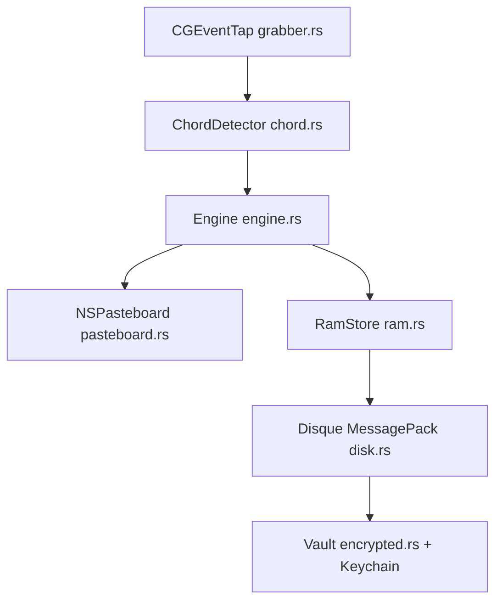

# shaaravraghu/ClipWallet

> Gestionnaire de presse-papiers macOS chiffré à plusieurs emplacements, piloté au clavier.

## Le problème
Chaque copie efface la précédente, et on perd ce qu'on avait copié trente secondes plus tôt.

## Ce que ça fait vraiment
Un démon Rust lancé par launchd intercepte des raccourcis clavier, garde 9 emplacements fixes ou un anneau de 50 entrées, écrit le tout sur disque en MessagePack et chiffre les entrées sensibles en AES-256-GCM, la clé étant dans le Trousseau macOS.

## Comment c'est branché
Schéma simplifié d'après la fiche, sans diagramme fourni.



## Essayer
```bash
curl -fsSL https://github.com/shaaravraghu/ClipWallet/releases/latest/download/install.sh | sh
clipwallet change mode
clipwallet status
```
La permission Accessibilité de macOS est obligatoire.

## Coût et pièges
Gratuit. Le README déconseille d'y stocker des mots de passe : l'historique persistant contourne l'effacement des gestionnaires de mots de passe. Les raccourcis ne sont pas modifiables pour l'instant.

## Ce que ce n'est pas
Pas multiplateforme : macOS seulement. Le dossier `store/` n'est pas chiffré, seul le vault l'est ; le qualificatif « militaire » du README est du marketing.

## Alternatives
Aucune alternative nommée dans le README.

## Pour toi
À ignorer : petit utilitaire macOS jeune et sans rapport avec ton travail data, IA ou MLOps, qui intercepte tout ton clavier.

