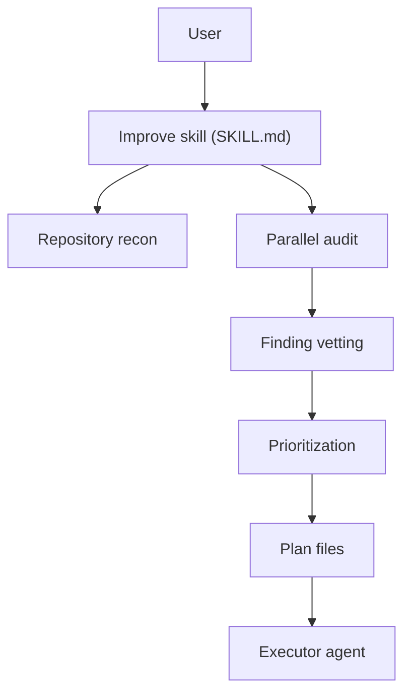

# shadcn/improve

> Agent skill that audits a repository and writes implementation plans executed by other agents.

## The problem
Cheap agents code well but judge poorly what to change; powerful models are expensive to run.

## What it actually does
`/improve` maps the repository, audits in parallel across nine categories (security, performance, tests, debt, dependencies, etc.), re-verifies every cited finding, ranks by impact over effort, then writes one plan per finding in `plans/`. It never modifies the code: `execute` delegates to a cheaper agent in an isolated worktree, `reconcile` refreshes the list.

## How it is wired


## Trying it
```bash
npx skills add shadcn/improve
```
```
/improve quick
/improve execute 001
```

## Cost and gotchas
Free, but the model of the auditing agent is at your expense; a deep audit launches several sub-agents in parallel. Works in an agent compatible with the Agent Skills format.

## What it is not
Implements nothing itself and never merges: the decision stays human. Skill sources not sampled.

## Alternatives
No alternative named in the README.

## For you
Adopt: handy for auditing an ML repository without touching the code, and the plans are Markdown readable before acting.
