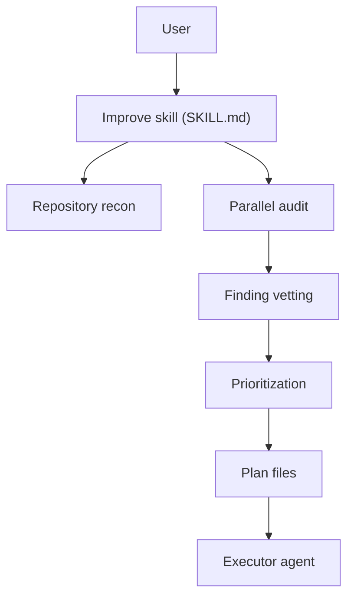

# shadcn/improve

> Skill d'agent qui audite un dépôt et écrit des plans d'implémentation exécutés par d'autres agents.

## Le problème
Les agents bon marché codent bien mais jugent mal quoi changer ; les modèles puissants coûtent cher à exécuter.

## Ce que ça fait vraiment
`/improve` cartographie le dépôt, audite en parallèle sur neuf catégories (sécurité, performance, tests, dette, dépendances, etc.), revérifie chaque constat cité, classe par rapport impact sur effort, puis écrit un plan par constat dans `plans/`. Il ne modifie jamais le code : `execute` délègue à un agent moins cher dans un worktree isolé, `reconcile` rafraîchit la liste.

## Comment c'est branché


## Essayer
```bash
npx skills add shadcn/improve
```
```
/improve quick
/improve execute 001
```

## Coût et pièges
Gratuit, mais le modèle de l'agent qui audite est à ta charge ; un audit approfondi lance plusieurs sous-agents en parallèle. Fonctionne dans un agent compatible avec le format Agent Skills.

## Ce que ce n'est pas
N'implémente rien lui-même et ne fusionne jamais : la décision reste humaine. Sources du skill non échantillonnées.

## Alternatives
Aucune alternative nommée dans le README.

## Pour toi
À adopter : pratique pour auditer un dépôt ML sans toucher au code, et les plans sont du Markdown lisible avant d'agir.

