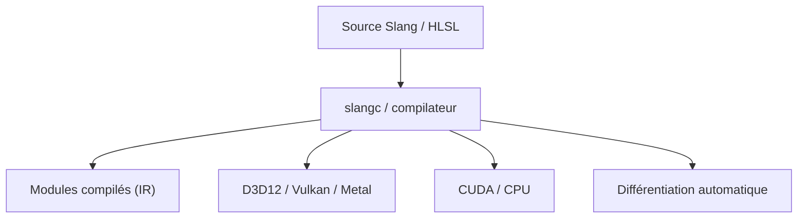

# shader-slang/slang

> Modular shader language and compiler targeting D3D, Vulkan, Metal, CUDA and CPU.

## The problem
Maintaining large shader codebases for multiple graphics APIs forces you to rewrite them and rely on the preprocessor.

## What it actually does
A compiler (`slangc` and library) generates D3D12, Vulkan, Metal, D3D11, CUDA and CPU from a HLSL-like source. Separately compilable modules, generics and interfaces, a capability system, forward and backward automatic differentiation, usable with PyTorch via `slangtorch`.

## How it is wired
Simplified diagram based on the sheet, no diagram provided.

## Trying it
No command in the README: it points to the GitHub release binaries, the `slangc` guide and the Slang Playground.

## Cost and gotchas
Free. x86_64 and aarch64 binaries for Windows, Linux, macOS, also in the Vulkan SDK. The GFX layer is being phased out in favor of slang-rhi. 1,990 open issues. License not identified by GitHub (Khronos Group CC-BY-4.0 header on the README).

## What it is not
Not a rendering engine. Not a machine learning framework: differentiation is mainly for differentiable rendering.

## Alternatives
No alternative named in the README (HLSL and GLSL compatibility).

## For you
Watch: `slangtorch` and automatic differentiation are of interest to an AI profile in neural graphics, but it is a niche domain.
