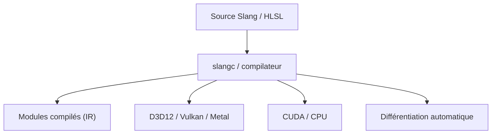

# shader-slang/slang

> Langage et compilateur de shaders modulaire, qui cible D3D, Vulkan, Metal, CUDA et CPU.

## Le problème
Maintenir de gros codes de shaders pour plusieurs API graphiques oblige à les réécrire et à recourir au préprocesseur.

## Ce que ça fait vraiment
Un compilateur (`slangc` et bibliothèque) génère D3D12, Vulkan, Metal, D3D11, CUDA et CPU à partir d'une source proche de HLSL. Modules compilables séparément, génériques et interfaces, système de capacités, différentiation automatique avant et arrière, utilisable avec PyTorch via `slangtorch`.

## Comment c'est branché
Schéma simplifié d'après la fiche, sans diagramme fourni.

## Essayer
Aucune commande dans le README : renvoi vers les binaires des releases GitHub, le guide `slangc` et le Slang Playground.

## Coût et pièges
Gratuit. Binaires x86_64 et aarch64 pour Windows, Linux, macOS, aussi dans le Vulkan SDK. Couche GFX en cours d'abandon au profit de slang-rhi. 1 990 issues ouvertes. Licence non identifiée par GitHub (en-tête CC-BY-4.0 du Khronos Group sur le README).

## Ce que ce n'est pas
Pas un moteur de rendu. Pas un framework de machine learning : la différentiation sert surtout au rendu différentiable.

## Alternatives
Aucune alternative nommée dans le README (compatibilité HLSL et GLSL).

## Pour toi
Surveiller : `slangtorch` et la différentiation automatique intéressent un profil IA en graphique neuronal, mais c'est un domaine de niche.

