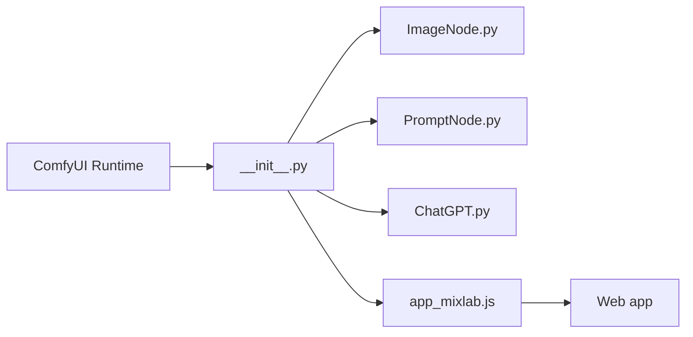

# shadowcz007/comfyui-mixlab-nodes

> Large ComfyUI node pack for images, prompts, 3D, LLMs, audio, and publishing workflows as web apps.

## The problem
Building creative ComfyUI workflows takes many scattered nodes, and sharing a workflow as an application is painful.

## What it actually does
Image nodes (layers, masks, rembg background removal), prompts (random, Chinese, ClipInterrogator), LLMs (OpenAI-compatible, Siliconflow, local), audio, TripoSR for 3D, screen sharing, video via fal.ai. The AppInfo node turns a workflow into a web app, with inputs and outputs limited to a few node types.

## How it is wired


## Trying it
```bash
cd ComfyUI/custom_nodes
git clone https://github.com/shadowcz007/comfyui-mixlab-nodes.git
cd comfyui-mixlab-nodes
pip3 install -r requirements.txt
```

## Cost and gotchas
Models must be downloaded by hand (TripoSR, rembg, lama...). Third-party APIs are at your expense. The README, a mix of Chinese and English changelogs, dates from an old torch 2.3.1 combination. The briarmbg model is non-commercial. 224 open issues.

## What it is not
Not a single coherent tool: a grab bag of nodes, some of them unmaintained.

## Alternatives
No alternative named in the README (related plugins such as comfyui-liveportrait).

## For you
Ignore for MLOps: only useful to creative ComfyUI users, and the whole thing is heavy and poorly documented.
