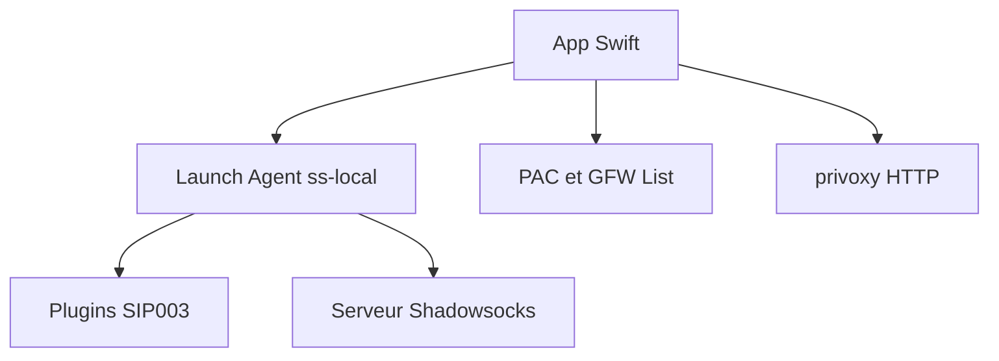

# shadowsocks/ShadowsocksX-NG

> macOS client in Swift for the Shadowsocks proxy, intended for anyone who has to configure a system SOCKS5 proxy.

## The problem
On macOS, wiring up a Shadowsocks client cleanly requires managing `ss-local`, the PAC and the proxy settings by hand.

## What it actually does
Swift interface that launches `ss-local` (copied from Homebrew) as a background Launch Agent. It manages server profiles (QR code, URL, clipboard), SIP003 plugins (kcptun, simple-obfs, v2ray-plugin), the PAC updated from the GFW List, and an HTTP proxy via privoxy. A manual mode avoids touching the system's proxy settings.

## How it is wired
Simplified diagram based on the sheet, no diagram provided.

## Trying it
No documented command: the README points to the GitHub releases download (macOS 10.12+).

## Cost and gotchas
You need an existing Shadowsocks server (third-party service); the software does not provide one. `ss-local` may keep running after the app is closed. Building: Xcode 12.5.1+ and CocoaPods 1.10.1+.

## What it is not
Not a VPN or a service: no server is provided. Not portable outside macOS. The README is short and documents neither installation nor troubleshooting.

## Alternatives
- ShadowsocksX (the original): the README cites it as the starting point of the rewrite, without recommending it.

## For you
Ignore for a data / AI / MLOps profile: it is a macOS proxy client unrelated to your pipelines, useful only if you already have a Shadowsocks server.
