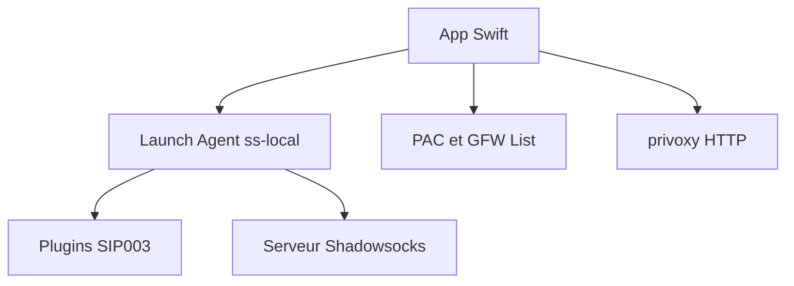

# shadowsocks/ShadowsocksX-NG

> Client macOS en Swift pour proxy Shadowsocks, destiné à qui doit configurer un proxy SOCKS5 système.

## Le problème
Sur macOS, brancher un client Shadowsocks proprement demande de gérer `ss-local`, le PAC et les réglages proxy à la main.

## Ce que ça fait vraiment
Interface Swift qui lance `ss-local` (copié depuis Homebrew) comme Launch Agent en arrière-plan. Gère les profils de serveur (QR code, URL, presse-papiers), les plugins SIP003 (kcptun, simple-obfs, v2ray-plugin), le PAC mis à jour depuis la GFW List, et un proxy HTTP via privoxy. Un mode manuel évite de toucher aux réglages proxy du système.

## Comment c'est branché
Schéma simplifié d'après la fiche, sans diagramme fourni.

## Essayer
Aucune commande documentée : le README renvoie au téléchargement des releases GitHub (macOS 10.12+).

## Coût et pièges
Il faut un serveur Shadowsocks existant (service tiers), le logiciel ne le fournit pas. `ss-local` peut continuer à tourner après la fermeture de l'app. Compilation : Xcode 12.5.1+ et CocoaPods 1.10.1+.

## Ce que ce n'est pas
Ce n'est pas un VPN ni un service : aucun serveur n'est fourni. Ce n'est pas portable hors macOS. Le README est court et ne documente ni installation ni dépannage.

## Alternatives
- ShadowsocksX (l'original) : le README le cite comme point de départ de la réécriture, sans le recommander.

## Pour toi
À ignorer pour un profil data / IA / MLOps : c'est un client de proxy macOS sans lien avec tes pipelines, utile seulement si tu as déjà un serveur Shadowsocks.

