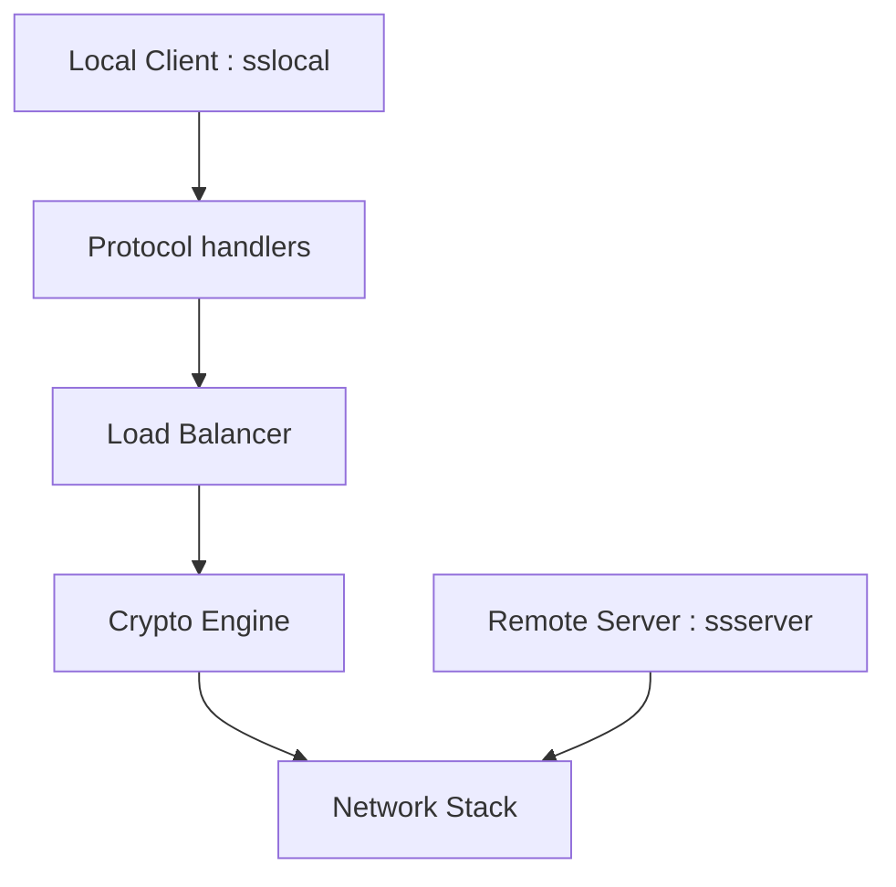

# shadowsocks/shadowsocks-rust

> Rust port of Shadowsocks, an encrypted proxy tunnel, for anyone who wants a lightweight client and server.

## The problem
Routing network traffic through an encrypted remote server when direct access is filtered or monitored.

## What it actually does
It provides `sslocal` (local client: SOCKS5, HTTP, tunnel, transparent redirection, DNS, TUN interface), `ssserver` and `ssmanager` to manage several servers. Configuration is in JSON, with several servers and latency-based selection. Plugins and ACLs are supported.

## How it is wired


## Trying it
```bash
cargo install shadowsocks-rust
ssservice genkey -m "aes-128-gcm"
sslocal -c config.json
ssserver -c config.json
```

## Cost and gotchas
Free, MIT license. Building from source: at least 2 GB of RAM. Stream ciphers are flagged as unsafe. Docker has no IPv6 by default. A remote server is at your expense.

## What it is not
It is not a full VPN by default: only the TUN mode comes close. It is not an anonymity tool, only an encrypted tunnel.

## Alternatives
No alternative named in the README, apart from the original Shadowsocks project, which is unmaintained.

## For you
Worth watching: useful for accessing resources from a filtered network, to keep at hand, with no direct link to data or AI.
