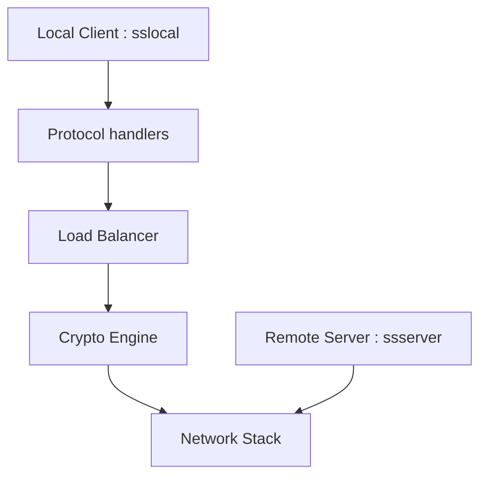

# shadowsocks/shadowsocks-rust

> Port Rust de Shadowsocks, un tunnel proxy chiffré, pour qui veut un client et un serveur légers.

## Le problème
Faire passer du trafic réseau par un serveur distant chiffré, quand l'accès direct est filtré ou surveillé.

## Ce que ça fait vraiment
Il fournit `sslocal` (client local SOCKS5, HTTP, tunnel, redirection transparente, DNS, interface TUN), `ssserver` et `ssmanager` pour gérer plusieurs serveurs. La configuration se fait en JSON, avec plusieurs serveurs et choix par latence. Des plugins et des ACL sont pris en charge.

## Comment c'est branché


## Essayer
```bash
cargo install shadowsocks-rust
ssservice genkey -m "aes-128-gcm"
sslocal -c config.json
ssserver -c config.json
```

## Coût et pièges
Gratuit, licence MIT. Compilation depuis les sources : au moins 2 Go de RAM. Les chiffrements en flux sont signalés comme non sûrs. Docker n'a pas IPv6 par défaut. Un serveur distant est à ta charge.

## Ce que ce n'est pas
Ce n'est pas un VPN complet par défaut : seul le mode TUN s'en approche. Ce n'est pas un outil d'anonymat, seulement un tunnel chiffré.

## Alternatives
Aucune alternative nommée dans le README, hors le projet Shadowsocks d'origine, non maintenu.

## Pour toi
Surveiller : utile pour accéder à des ressources depuis un réseau filtré, à garder sous la main sans lien direct avec la data ou l'IA.

