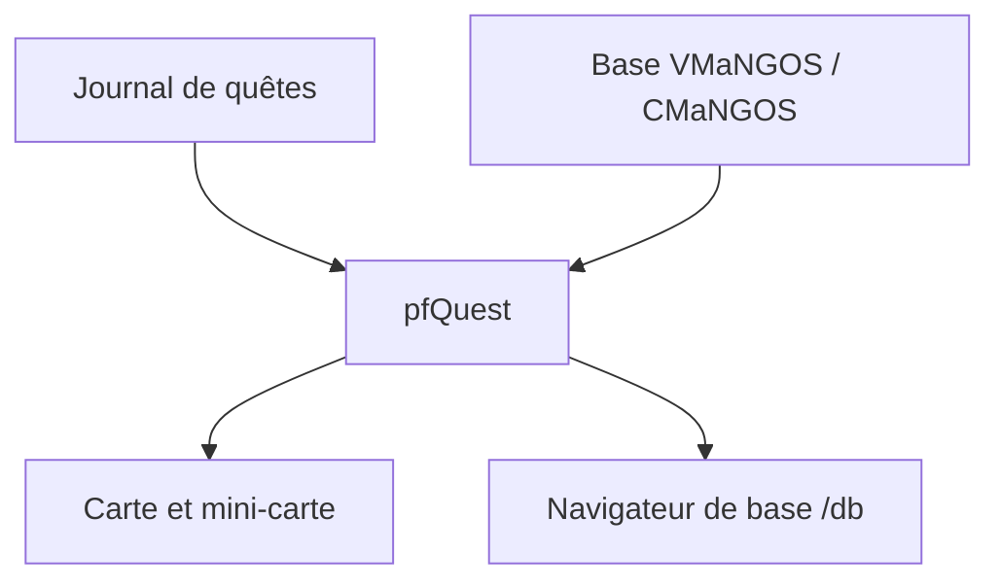

# shagu/pfQuest

> World of Warcraft Vanilla and Burning Crusade addon that places quest items and objectives on the map.

## The problem
In the original game, finding where a monster, an item or a quest objective is located forces you to search the web.

## What it actually does
Reads quest objectives, matches them against an internal database (VMaNGOS for Vanilla, CMaNGOS for TBC) and displays the results on the map and minimap. Provides a database browser, four automatic tracking modes and a `/db` command line (for example `/db track mines`). A beta version runs on a WotLK client without its own database. The database takes about 80 MB of memory.

## How it is wired
Simplified diagram based on the sheet, no diagram provided.



## Trying it
```bash
/db show
/db object Iron Deposit
/db track mines 150 225
```
Installation: unzip `pfQuest-full.zip` into `Wow-Directory\Interface\AddOns`, restart WoW.

## Cost and gotchas
Free. To avoid the memory warning, set "Script Memory" to 0. Repository archived, last push in August 2025.

## What it is not
Not a quest guide: it aims at an in-game version of AoWoW or Wowhead. No WotLK database for now.

## Alternatives
No alternative named in the README (ShaguQuest, its predecessor, is mentioned).

## For you
Ignore: archived game addon, outside any data, AI or MLOps use.
