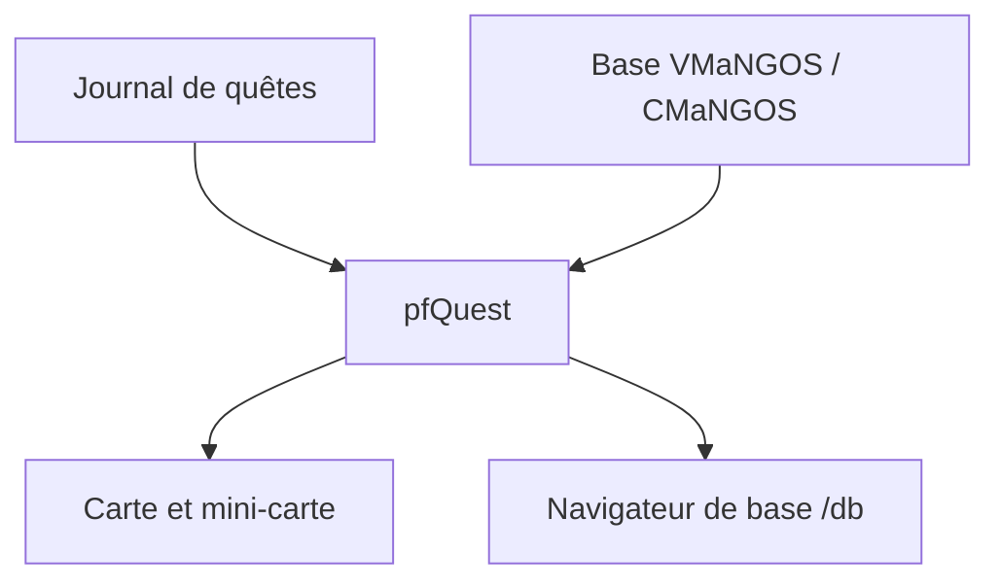

# shagu/pfQuest

> Addon World of Warcraft Vanilla et Burning Crusade qui place sur la carte les objets et objectifs de quête.

## Le problème
Dans le jeu d'origine, retrouver où se trouvent un monstre, un objet ou un objectif de quête oblige à chercher sur le web.

## Ce que ça fait vraiment
Lit les objectifs de quête, les confronte à une base interne (VMaNGOS pour Vanilla, CMaNGOS pour TBC) et affiche les résultats sur la carte et la mini-carte. Fournit un navigateur de base de données, quatre modes de suivi automatique et une ligne de commande `/db` (par exemple `/db track mines`). Une version bêta tourne sur un client WotLK sans base propre. La base pèse environ 80 Mo en mémoire.

## Comment c'est branché
Schéma simplifié d'après la fiche, sans diagramme fourni.



## Essayer
```bash
/db show
/db object Iron Deposit
/db track mines 150 225
```
Installation : décompresser `pfQuest-full.zip` dans `Wow-Directory\Interface\AddOns`, redémarrer WoW.

## Coût et pièges
Gratuit. Pour éviter l'avertissement de mémoire, régler « Script Memory » à 0. Dépôt archivé, dernier push en août 2025.

## Ce que ce n'est pas
Pas un guide de quête : il vise une version en jeu d'AoWoW ou Wowhead. Pas de base WotLK pour l'instant.

## Alternatives
Aucune alternative nommée dans le README (ShaguQuest, son prédécesseur, est cité).

## Pour toi
À ignorer : addon de jeu archivé, hors de tout usage data, IA ou MLOps.

