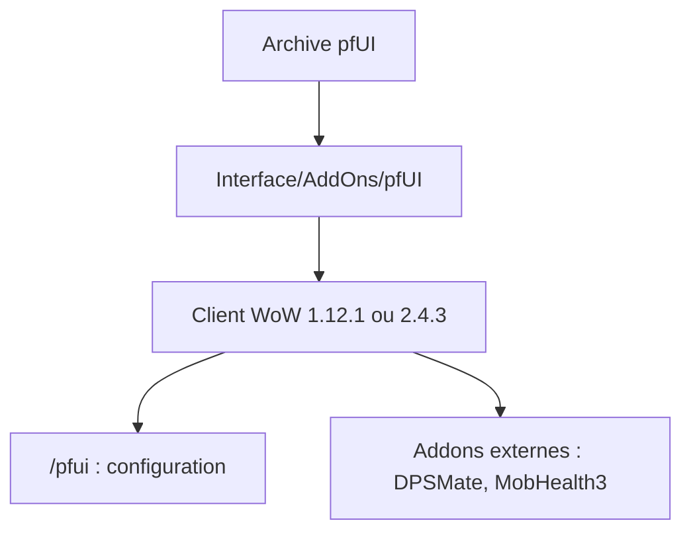

# shagu/pfUI

> Full replacement interface addon for World of Warcraft Vanilla (1.12.1) and Burning Crusade (2.4.3).

## The problem
The original interface of old WoW versions lacks modern features and a clean style.

## What it actually does
pfUI replaces the interface with unit frames, action bars and chat, written from scratch without any third-party library. It offers commands (`/pfui`, `/focus`, `/pfcast`), eight client languages and supports external addons without bundling them. There is no port to the recent "Classic" versions.

## How it is wired
Simplified diagram based on the sheet, no diagram provided.


## Trying it
```text
1. Download the latest release and unzip the archive.
2. Rename the folder "pfUI-master" to "pfUI" (or "pfUI-tbc" for Burning Crusade).
3. Copy it into Wow-Directory\Interface\AddOns, then restart WoW.
```

## Cost and gotchas
Free. Archived repository, last push in August 2025; the README asks not to redistribute outdated versions.

## What it is not
It is not compatible with current Classic clients, nor an addon pack.

## Alternatives
- ShaguUI: addon pack, which the README distinguishes from pfUI.

## For you
Ignore: archived game addon, unrelated to your job.
