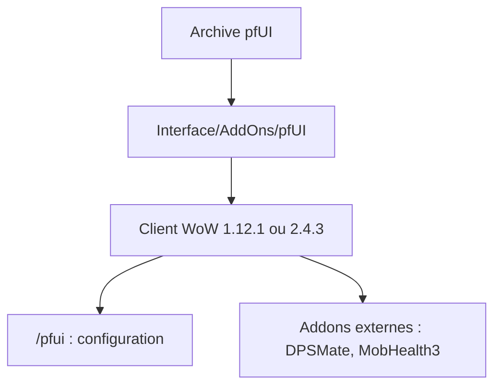

# shagu/pfUI

> Addon de remplacement complet de l'interface de World of Warcraft Vanilla (1.12.1) et Burning Crusade (2.4.3).

## Le problème
L'interface d'origine des anciennes versions de WoW manque de fonctions modernes et d'un style sobre.

## Ce que ça fait vraiment
pfUI remplace l'interface avec des cadres d'unités, des barres d'action et du chat, écrits de zéro sans bibliothèque tierce. Il offre commandes (`/pfui`, `/focus`, `/pfcast`), huit langues de client et prend en charge des addons externes sans les embarquer. Pas de portage vers les versions « Classic » récentes.

## Comment c'est branché
Schéma simplifié d'après la fiche, sans diagramme fourni.


## Essayer
```text
1. Télécharger la dernière version et décompresser l'archive.
2. Renommer le dossier "pfUI-master" en "pfUI" (ou "pfUI-tbc" pour Burning Crusade).
3. Copier dans Wow-Directory\Interface\AddOns, puis relancer WoW.
```

## Coût et pièges
Gratuit. Dépôt archivé, dernier push en août 2025 ; le README demande de ne pas redistribuer de versions périmées.

## Ce que ce n'est pas
Ce n'est pas compatible avec les clients Classic actuels, ni un pack d'addons.

## Alternatives
- ShaguUI : pack d'addons, que le README distingue de pfUI.

## Pour toi
À ignorer : addon de jeu archivé, sans rapport avec ton métier.

