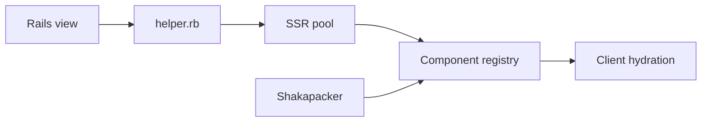

# shakacode/react_on_rails

> Integrates React into Ruby on Rails applications, with server-side rendering and automatic bundling.

## The problem
Keep a single Rails application while using React, without splitting front end and API.

## What it actually does
A `react_component` helper in Rails views, server-side rendering, hot reloading, bundle generation with Shakapacker (Rspack possible). Pro version: Node renderer, streaming SSR, React Server Components, fragment caching, TanStack Router.

## How it is wired


## Trying it
```bash
npx create-react-on-rails-app my-app
cd my-app
bin/rails db:prepare
bin/dev
```

## Cost and gotchas
New applications use Pro by default. Pro is free except for production use in a large organization ($1,800/year). License not identified by GitHub.

## What it is not
Not a Python tool (the deployment field is not gem); it is a Ruby gem.

## Alternatives
No alternative cited in the README (a comparison page exists).

## For you
Ignore: specific to Rails + React, outside the data / AI / MLOps profile.
