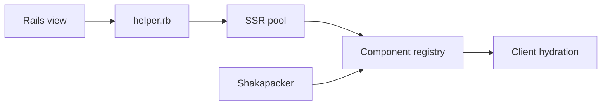

# shakacode/react_on_rails

> Intègre React dans les applications Ruby on Rails, avec rendu serveur et bundling automatique.

## Le problème
Garder une seule application Rails tout en utilisant React sans séparer front et API.

## Ce que ça fait vraiment
Helper `react_component` dans les vues Rails, rendu côté serveur, rechargement à chaud, génération de bundles avec Shakapacker (Rspack possible). Version Pro : Node renderer, SSR en streaming, React Server Components, cache de fragments, TanStack Router.

## Comment c'est branché


## Essayer
```bash
npx create-react-on-rails-app my-app
cd my-app
bin/rails db:prepare
bin/dev
```

## Coût et pièges
Les nouvelles applications utilisent Pro par défaut. Pro gratuit sauf production dans une grande organisation (1 800 $/an). Licence non identifiée par GitHub.

## Ce que ce n'est pas
Pas un outil Python (le champ de déploiement n'est pas gem) ; c'est un gem Ruby.

## Alternatives
Aucune alternative citée dans le README (une page de comparaison existe).

## Pour toi
À ignorer : spécifique à Rails + React, hors profil data / IA / MLOps.

