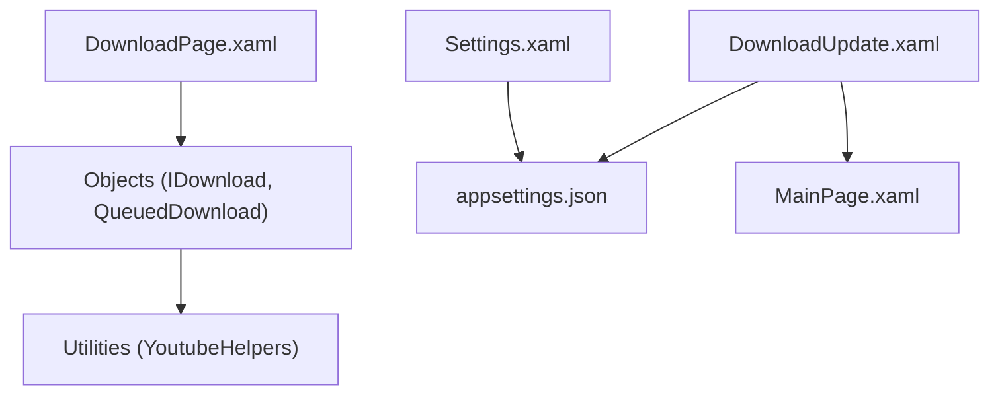

# shaked6540/YoutubePlaylistDownloader

> Windows (WPF) application to download YouTube playlists, channels or videos and convert them.

## The problem
Fetching a whole playlist by hand, video by video, and converting it to audio or video is time-consuming.

## What it actually does
Downloads YouTube playlists, channels or videos, converts to several formats and automatically tags artist, album, title and genre from the video title. The interface is localized in fourteen languages, with themes and an update system. The C# code separates XAML views, download objects and YouTube helpers.

## How it is wired

## Trying it
No command documented in the README: download the installer; on failure, check `%APPDATA%\Youtube Playlist Downloader\Errors.txt`.

## Cost and gotchas
Free, no ads. The architecture indicates a WPF application, hence Windows. Downloading YouTube content may violate the terms of service (not addressed in the README).

## What it is not
Not a cross-platform or command-line tool. Not a service: everything runs locally.

## Alternatives
No alternative cited in the README.

## For you
Ignore: consumer Windows utility, no link with a data flow; to build an audio corpus, a command-line tool would be more scriptable.
