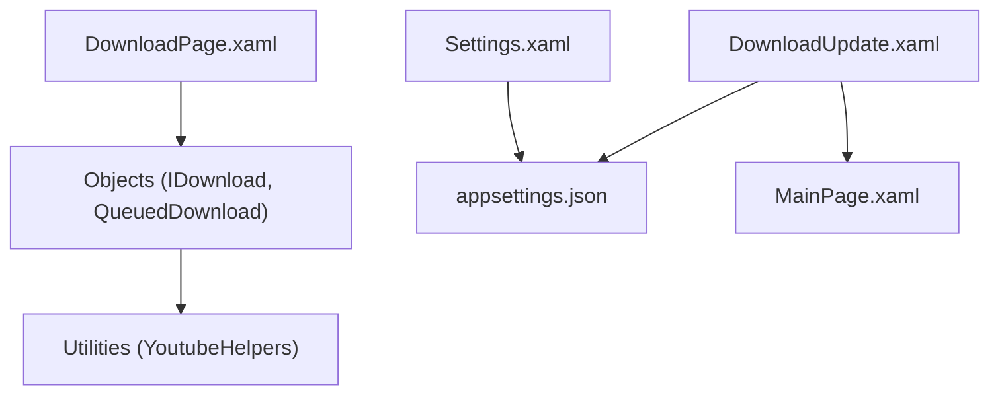

# shaked6540/YoutubePlaylistDownloader

> Application Windows (WPF) pour télécharger des playlists, chaînes ou vidéos YouTube et les convertir.

## Le problème
Récupérer une playlist entière à la main, vidéo par vidéo, et la convertir en audio ou vidéo est long.

## Ce que ça fait vraiment
Télécharge playlists, chaînes ou vidéos YouTube, convertit vers plusieurs formats et étiquette automatiquement artiste, album, titre et genre d'après le titre de la vidéo. L'interface est localisée en quatorze langues, avec thèmes et système de mise à jour. Le code C# sépare vues XAML, objets de téléchargement et helpers YouTube.

## Comment c'est branché

## Essayer
Aucune commande documentée dans le README : installeur à télécharger ; en cas d'échec, consulter `%APPDATA%\Youtube Playlist Downloader\Errors.txt`.

## Coût et pièges
Gratuit, sans publicité. L'architecture indique une application WPF donc Windows. Le téléchargement de contenu YouTube peut contrevenir aux conditions du service (non traité dans le README).

## Ce que ce n'est pas
Pas un outil multiplateforme ni en ligne de commande. Pas un service : tout tourne en local.

## Alternatives
Aucune alternative citée dans le README.

## Pour toi
Ignorer : utilitaire grand public Windows, aucun lien avec un flux data ; pour constituer un corpus audio, un outil en ligne de commande serait plus scriptable.

